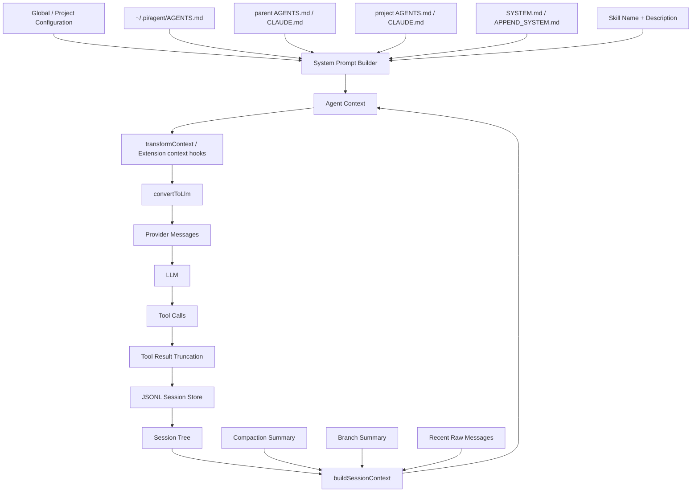
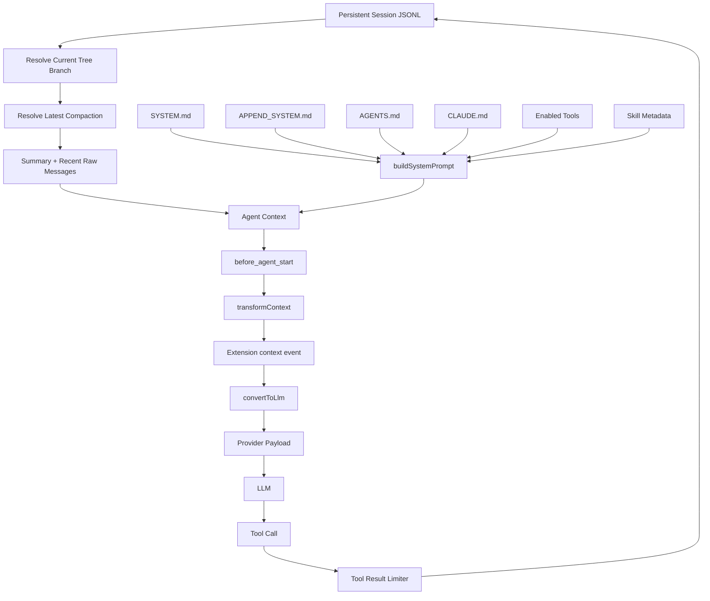
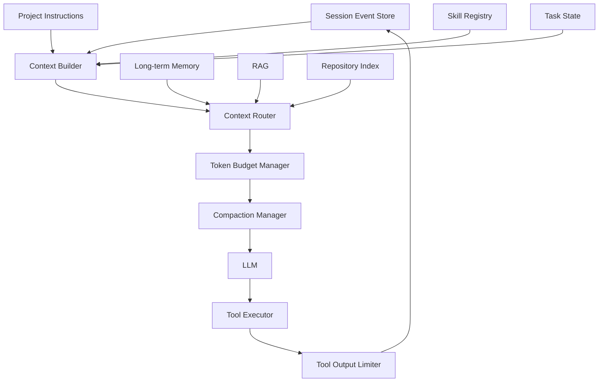

# Pi Agent 上下文工程技术实现调研

> 调研对象：Pi Agent Harness / Pi Coding Agent
> 当前官方仓库：`earendil-works/pi`
> 调研时间：2026-09-14
> 重点：Context Engineering、Session、Compaction、Project Context、Skills、Tool Context、Extension Hooks、Prompt Cache
> 说明：本文优先依据 Pi 官方文档和官方源码。涉及架构评价与自研建议的部分会明确标记为“分析/建议”。

---

## 1. 结论先行

Pi 的上下文工程并不是单独依赖“长上下文模型”或者“对历史消息做摘要”，而是一套分层的上下文管理架构。

其核心可以概括成：

```text
持久化完整历史
        ↓
根据当前 Session Tree 选择当前分支
        ↓
用 Compaction Summary 替换过旧历史
        ↓
保留最近一段原始消息
        ↓
叠加 System Prompt / AGENTS.md / Skills 索引
        ↓
每次 LLM 调用前允许 Extension 动态裁剪或注入消息
        ↓
控制 Tool Result 大小
        ↓
转换成 Provider Message → 调用模型
```

Pi 最值得借鉴的并不是某一个具体算法，而是下面 6 个设计原则：

1. **完整历史和活跃上下文分离**：完整 Session 永久保存，但并不意味着每次都发给模型。
2. **上下文是可重建的**：当前 LLM Context 是由 Session Tree、Compaction Entry、Project Context 等动态计算出来的。
3. **“最近原文 + 远期摘要”混合**：不是把所有历史都摘要，而是保留最近约 20K token 原文。
4. **上下文按需披露**：Skills 只把名称和描述长期放入 Prompt，完整 Skill 内容在需要时再读取。
5. **Tool Result 必须限流**：工具返回内容本身也是上下文预算的重要消费者。
6. **为上下文提供 Hook**：开发者可以在模型调用前、压缩前、Provider 请求前修改上下文。

这是一种非常典型的 **Context Engineering Pipeline**，而不是单纯的 Conversation Memory。

---

# 2. Pi 当前项目状态

Pi 最初主要位于：

```text
badlogic/pi-mono
@mariozechner/pi-coding-agent
```

2026 年 5 月，项目迁移到了 Earendil Works：

```text
GitHub:
earendil-works/pi

npm:
@earendil-works/pi-coding-agent
@earendil-works/pi-agent-core
@earendil-works/pi-ai
```

旧的 `@mariozechner/*` npm package 已被弃用。

官方说明：

- Pi Has a New Home at Earendil
  https://pi.dev/news/2026/5/7/pi-has-a-new-home

因此，如果你现在准备阅读源码，建议直接基于：

```text
https://github.com/earendil-works/pi
```

而不是旧版 `badlogic/pi-mono`。

---

# 3. Pi 的整体上下文架构

可以把 Pi 的 Context Engineering 拆成 7 层。



从工程角度看，可以把最终 LLM 请求理解成：

```text
LLM Context =
    Stable System Prompt
  + Project Instructions
  + Skill Index
  + Compacted Historical State
  + Recent Raw Conversation
  + Current Tool Results
  + Per-turn Dynamic Context
```

---

# 4. System Prompt：上下文的第一层

核心源码：

```text
packages/coding-agent/src/core/system-prompt.ts
```

核心函数：

```ts
buildSystemPrompt(options)
```

当前源码中的主要输入包括：

```ts
interface BuildSystemPromptOptions {
  customPrompt?: string;
  selectedTools?: string[];
  toolSnippets?: Record<string, string>;
  promptGuidelines?: string[];
  appendSystemPrompt?: string;
  cwd: string;
  contextFiles?: Array<{
    path: string;
    content: string;
  }>;
  skills?: Skill[];
}
```

也就是说，Pi 并不是维护一个固定 System Prompt，而是运行时根据：

- 当前启用的 Tool
- Tool 的 Prompt Guideline
- 用户自定义 Prompt
- Project Context
- Skills
- cwd

动态生成。

---

## 4.1 Project Context 注入

Pi 会加载项目中的：

```text
~/.pi/agent/AGENTS.md
父目录 AGENTS.md / CLAUDE.md
当前项目 AGENTS.md / CLAUDE.md
```

这些内容最后进入 System Prompt。

当前源码已经使用显式 XML Boundary：

```xml
<project_context>

Project-specific instructions and guidelines:

<project_instructions path="/project/AGENTS.md">
...
</project_instructions>

</project_context>
```

这个细节非常值得学习。

原因是，如果简单写成：

```markdown
## /project/AGENTS.md

## Coding Rules
...
```

那么文件内部 Markdown Heading 很容易与 Prompt 的结构发生混淆。

使用：

```xml
<project_instructions path="...">
...
</project_instructions>
```

相当于给不同来源的 Context 增加了清晰的边界。

### 自研时建议

不要简单做：

```python
system_prompt += open("AGENTS.md").read()
```

更推荐：

```xml
<context_source
    type="project_instruction"
    path="project/AGENTS.md"
    priority="high">
...
</context_source>
```

这样后续可以进一步支持：

- Context priority
- Context source tracking
- Context expiration
- Context debugging

---

# 5. Project Context 的加载机制

相关源码：

```text
packages/coding-agent/src/core/resource-loader.ts
```

Pi 的一个重要思想是：

> Context 本身也是 Resource。

Pi 的 Resource Loader 不只处理 AGENTS.md，同时负责或参与：

- Context Files
- Skills
- Extensions
- Prompt Templates
- Themes
- Pi Packages

因此上下文不是散落在 CLI 各处的字符串拼接，而是通过统一 Resource Discovery 管理。

SDK 中甚至公开了：

```ts
loadProjectContextFiles()
```

以及：

```ts
DefaultResourceLoader
```

示例：

```ts
const loader = new DefaultResourceLoader({
  cwd: process.cwd(),
  agentDir: getAgentDir(),
});

await loader.reload();

const discovered =
  loader.getAgentsFiles().agentsFiles;
```

这意味着 Project Context 在设计上属于“可发现资源”，而不是简单配置文件。

---

# 6. Skills：Pi 非常重要的 Progressive Disclosure

官方文档：

```text
packages/coding-agent/docs/skills.md
```

Pi Skills 遵循 Agent Skills 思路。

Skill 基本结构：

```text
my-skill/
├── SKILL.md
├── scripts/
├── references/
└── assets/
```

例如：

```yaml
---
name: pdf-processing
description: Extract PDF text and tables...
---
```

Pi 并不会在启动时把所有 `SKILL.md` 全文放入上下文。

它采用：

```text
启动
 ↓
扫描所有 Skills
 ↓
只读取 name + description
 ↓
把 Skill 列表放入 System Prompt
 ↓
模型判断某 Skill 与任务相关
 ↓
模型通过 read/bash 读取完整 SKILL.md
 ↓
按 Skill 执行
```

即：

```text
Metadata Always In Context
Full Content On Demand
```

官方直接将这种机制称为：

> Progressive Disclosure

---

## 6.1 为什么这个设计很重要

假设你有 100 个 Skills：

```text
SQL
PDF
Excel
Browser
Git
Deployment
Testing
RAG
Database
...
```

如果每个 Skill 2K token，那么：

```text
100 × 2K = 200K token
```

模型还没开始执行任务，上下文已经被技能说明填满。

Pi 的方案则可能只需要：

```text
Skill Name + Description
≈ 30 ~ 100 tokens / Skill
```

只有真正需要的 Skill 才展开。

---

## 6.2 这个设计可以进一步抽象成

```text
L0: capability metadata
L1: capability instructions
L2: capability references
L3: external artifacts / scripts
```

例如：

```text
SQL Skill
│
├── L0: "SQL optimization skill"
│
├── L1: SKILL.md
│
├── L2: postgres.md
│       mysql.md
│       kingbase.md
│
└── L3: scripts/
```

模型逐层读取，而不是一次性全部注入。

这是一个非常值得你在自己的 Agent 中实现的 Context Engineering 模式。

---

# 7. Session：完整历史并不等于 LLM Context

Pi 的 Session 采用 JSONL。

核心源码：

```text
packages/coding-agent/src/core/session-manager.ts
```

默认位置类似：

```text
~/.pi/agent/sessions/
```

关键点是：

> Pi 的 Session 不是简单线性 messages[]，而是 Tree。

每个 Entry 基本带有：

```ts
{
  id: string;
  parentId: string | null;
  timestamp: string;
}
```

形成：

```text
A
│
├── B
│   └── C
│
└── D
    └── E
```

当前 `leafId` 指向当前所在分支。

---

# 8. 为什么 Session Tree 对 Context Engineering 很重要

普通 Agent 通常：

```python
messages = [
  user,
  assistant,
  tool,
  user,
  assistant
]
```

如果用户回到较早位置重新尝试，就需要：

- copy conversation
- 新开 Session
- 或删除后面的消息

Pi 则可以：

```text
          C ---- D
         /
A ---- B
         \
          E ---- F
```

完整历史都保留。

当前 Context 只沿：

```text
root → current leaf
```

构造。

这使得：

- branch
- fork
- rollback
- alternate reasoning path

成为 Session Model 的一部分。

---

# 9. buildSessionContext：真正发送给模型的历史是动态计算的

核心函数：

```ts
buildSessionContext(...)
```

逻辑大致是：

```ts
const path =
  buildSessionPath(entries, leafId);

const messages =
  buildContextEntries(
    entries,
    leafId
  ).flatMap(
    sessionEntryToContextMessages
  );

return {
  messages,
  thinkingLevel,
  model
};
```

因此：

```text
Session File
≠
LLM Messages
```

真正的关系是：

```text
Session Entries
      ↓
Session Path Resolution
      ↓
Compaction Resolution
      ↓
Entry → AgentMessage
      ↓
LLM Context
```

这是 Pi 上下文工程的核心设计之一。

---

# 10. Session Entry 不只是 Message

Pi 的 Session 里除了普通消息，还包含很多特殊 Entry：

```text
message
compaction
branch_summary
custom
custom_message
model_change
thinking_level_change
label
session_info
```

其中有一个很值得学习的区别：

## custom

用于持久化 Extension 状态：

```text
进入 Session Store
不进入 LLM Context
```

## custom_message

用于：

```text
进入 Session Store
并进入 LLM Context
```

这意味着 Pi 在数据模型层面就区分了：

```text
Agent Runtime State
```

和：

```text
Model-visible Context
```

这是非常正确的工程设计。

---

# 11. Context Compaction：Pi 长上下文管理的核心

官方文档：

```text
https://pi.dev/docs/latest/compaction
```

核心源码：

```text
packages/coding-agent/src/core/compaction/compaction.ts
packages/coding-agent/src/core/compaction/utils.ts
```

---

## 11.1 自动触发条件

Pi 使用：

```text
contextTokens >
contextWindow - reserveTokens
```

默认：

```json
{
  "compaction": {
    "enabled": true,
    "reserveTokens": 16384,
    "keepRecentTokens": 20000
  }
}
```

即：

```text
reserveTokens = 16,384
keepRecentTokens = 20,000
```

假设模型 Context Window 为：

```text
200K
```

大约在：

```text
200K - 16K
≈ 184K
```

左右开始考虑压缩。

---

# 12. Pi 不是“把全部历史摘要掉”

它采用：

```text
旧历史 → Summary
最近历史 → Raw Messages
```

即：

```text
┌─────────────────────────────┐
│ System Prompt               │
├─────────────────────────────┤
│ Historical Summary          │
├─────────────────────────────┤
│ Recent Raw Messages ~20K    │
├─────────────────────────────┤
│ Current User Message        │
└─────────────────────────────┘
```

这实际上是一种：

> Recency-preserving Compaction

最近上下文通常包含：

- 当前代码位置
- 当前错误
- 最近 Tool Result
- 当前执行计划

因此保留原文比对所有历史统一摘要更可靠。

---

# 13. Compaction 的具体流程

官方流程可以概括成：

```text
1. 从最新消息向前扫描
2. 保留约 keepRecentTokens
3. 找到 Cut Point
4. 将 Cut Point 之前的历史序列化
5. 调用 LLM 生成结构化 Summary
6. 写入 CompactionEntry
7. 重新 buildSessionContext()
```

伪代码：

```python
def compact(session):
    path = get_active_branch(session)

    keep = collect_recent_messages(
        path,
        token_budget=20_000
    )

    old_messages = path.before(keep)

    summary = summarize(
        old_messages,
        previous_summary=session.previous_summary
    )

    session.append(
        CompactionEntry(
            summary=summary,
            first_kept_entry_id=keep[0].id
        )
    )
```

---

# 14. Compaction 并不会删除历史

这是 Pi 很关键的一个实现。

假设原历史：

```text
1 user
2 assistant
3 tool
4 user
5 assistant
6 tool
7 assistant
8 tool
```

压缩之后并不是：

```text
summary
7 assistant
8 tool
```

覆盖掉原来的 Session。

而是 Session 仍然保留：

```text
1
2
3
4
5
6
7
8
9 compaction
```

其中：

```ts
CompactionEntry {
  summary
  firstKeptEntryId
  tokensBefore
}
```

之后构建上下文时：

```text
忽略旧的 1~6 原文
使用 summary
继续使用 7~8 原文
```

所以：

```text
Disk History = Lossless
Active LLM Context = Lossy
```

这是非常好的设计。

---

# 15. firstKeptEntryId：一个非常值得学习的字段

Compaction Entry 中记录：

```ts
firstKeptEntryId
```

它告诉 Context Builder：

```text
Summary 覆盖到哪里
Raw Message 从哪里继续
```

因此最终上下文是：

```text
Compaction Summary
+
messages[firstKeptEntryId ... currentLeaf]
```

这样不需要修改历史数据。

---

# 16. 多次 Compaction：Summary 会递归接力

Pi 支持：

```text
第一次：
History A → Summary A
保留 Recent B

第二次：
Summary A + B 的较旧部分
       ↓
Summary AB
保留 Recent C
```

而不是：

```text
Summary A 永久不变
```

所以长期 Session 会形成一种：

```text
Rolling Summary
```

或者：

```text
Recursive Context Handoff
```

这是 Agent 长任务非常实用的模式。

---

# 17. Compaction Summary 不是普通自然语言摘要

Pi 使用结构化摘要。

大致模板：

```markdown
## Goal

## Constraints & Preferences

## Progress

### Done

### In Progress

### Blocked

## Key Decisions

## Next Steps

## Critical Context

<read-files>
...
</read-files>

<modified-files>
...
</modified-files>
```

这里非常值得注意的是：

Pi 不是要求模型回答：

```text
总结一下之前的对话。
```

而是明确要求抽取：

```text
Goal
Constraints
Progress
Decision
Next Steps
Critical Context
Files
```

这本质上是在做：

> State Distillation

而不是 Conversation Summarization。

---

# 18. File Operation Tracking

Pi 在 Compaction 时还额外记录：

```ts
interface CompactionDetails {
  readFiles: string[];
  modifiedFiles: string[];
}
```

文件操作信息来自：

- Tool Calls
- Previous Compaction
- Branch Summary

并且是累积的。

因此即使某个文件的读取操作已经被摘要掉，后续 Summary 仍然能够知道：

```text
哪些文件读过
哪些文件修改过
```

这对于 Coding Agent 特别重要。

---

# 19. 为什么单独追踪 Files 很有价值

普通 Summary 很可能把：

```text
src/service/order.ts
src/db/models.ts
tests/order.test.ts
```

遗漏。

但对于代码 Agent：

```text
已修改文件集合
```

属于“结构化状态”，不应该只依赖 LLM 自由摘要。

这个思想可以进一步扩展。

自研 Agent 可以把 State 分为：

```text
Natural-language State
+
Structured State
```

例如：

```json
{
  "summary": "...",
  "files_read": [],
  "files_modified": [],
  "commands_run": [],
  "artifacts_created": [],
  "decisions": [],
  "todo": []
}
```

可靠性会比纯文本摘要更高。

---

# 20. Compaction 对 Tool Result 再做一次压缩

进行 Summary 时，Pi 会把 Conversation 序列化成：

```text
[User]: ...
[Assistant thinking]: ...
[Assistant]: ...
[Assistant tool calls]: ...
[Tool result]: ...
```

而 Tool Result 在 Summarization Payload 中最多保留：

```text
2000 characters
```

超过部分会变成：

```text
[... N more characters truncated]
```

原因很简单：

```text
Tool Output 通常是上下文中最大的 token 消费者。
```

因此 Pi 有两层 Tool Output 控制：

```text
第一层：
正常 Agent Context 中限制 Tool Output

第二层：
Compaction Summarization 时进一步限制 Tool Output
```

---

# 21. Split Turn：单个 Agent Turn 太长怎么办

Pi 还处理一个很容易被忽视的问题：

```text
一个 user turn 本身就超过 keepRecentTokens
```

例如：

```text
User
 ↓
Assistant
 ↓
Tool
 ↓
Assistant
 ↓
Tool
 ↓
Assistant
 ↓
Tool
...
```

如果一个 Turn 内 Tool Loop 很长，那么 Cut Point 可能落在 Turn 中间。

Pi 称为：

```text
Split Turn
```

此时它会分别处理：

```text
Previous History
+
Current Turn Prefix
```

再进行组合。

同时 Pi 有一个重要规则：

> 不在 Tool Result 上切断。

因为：

```text
Tool Call
Tool Result
```

是语义耦合的。

如果只保留 Result 不保留 Call，或者相反，模型会看到破碎上下文。

---

# 22. 当前版本已经支持 Agent Run 中间检查 Compaction

早期 Agent 框架常见一个问题：

```text
只在 User Turn 结束后检查 Context Size。
```

如果一个 Tool Loop：

```text
read
→ bash
→ grep
→ read
→ edit
→ test
→ read
...
```

可能在同一个 Turn 内就把 Context 撑爆。

Pi 当前官方文档说明：

```text
Tool Result 加入上下文后、
下一次 Assistant Response 开始前，
会检查 Compaction Threshold。
```

所以长 Tool Loop 中也可以触发压缩，而不必等待新的 User Message。

这是 Context Engineering 中一个非常重要的工程细节。

---

# 23. Branch Summarization

除了 Context Compaction，Pi 还有：

```text
Branch Summarization
```

使用 `/tree` 从一个对话分支返回另一个分支时，可以把“被离开的分支”生成 Summary。

例如：

```text
         B → C → D
        /
A -----
        \
         E → F
```

从 D 跳到 F 时：

```text
B/C/D
 ↓
Branch Summary
 ↓
插入 F 分支
```

变成：

```text
A → E → F → Summary(B,C,D)
```

这样模型虽然切换了 Branch，仍然知道刚才在另一个 Branch 做过什么。

这实际上是一种：

> Cross-branch State Transfer

---

# 24. Tool Result Truncation：上下文工程中非常容易被忽略的一层

Pi 官方明确要求：

> Tools MUST truncate their output to avoid overwhelming the LLM context.

默认限制：

```text
50 KB
或
2000 lines
```

哪个先达到就截断。

---

## 24.1 不同 Tool 使用不同策略

例如：

### read / search

更重要的是开头：

```text
truncateHead
```

### bash / log

更重要的是最新输出：

```text
truncateTail
```

例如测试命令：

```text
npm test
```

真正需要的通常是最后：

```text
FAIL
Stack Trace
Error
```

而不是日志开头。

---

## 24.2 截断后并不是直接丢掉完整输出

Pi 会：

```text
Agent Context:
只保存截断结果

Disk / Temp:
保存完整结果
```

然后告诉模型：

```text
Output truncated...
Full output saved to:
...
```

模型如果真的需要，可以再调用 Tool 去读取完整内容。

这也是 Progressive Disclosure：

```text
Tool Output Summary
        ↓
Full Output On Demand
```

---

# 25. Extension Context Hook：每次 LLM Call 前还能改 Context

Pi 的 Extension API 提供：

```ts
pi.on("context", ...)
```

官方定义：

> Fired before each LLM call.

例如：

```ts
pi.on("context", async (event, ctx) => {
  const filtered =
    event.messages.filter(
      m => !shouldPrune(m)
    );

  return {
    messages: filtered
  };
});
```

这意味着 Context 并不是 Session Builder 构建完之后就固定了。

真正流程类似：

```text
Session Context
      ↓
Extension Context Hook
      ↓
Provider Message
```

这给用户提供了二次 Context Engineering 的机会。

---

# 26. before_agent_start：动态 System Prompt

另一个 Hook：

```ts
pi.on("before_agent_start", ...)
```

可以：

```text
修改 System Prompt
注入 Custom Message
```

例如可以实现：

```text
检测当前 Git Branch
↓
检测任务类型
↓
动态注入不同项目规则
```

甚至可以做：

```text
如果任务是数据库
→ 加载 DB Context

如果任务是前端
→ 加载 Frontend Context
```

这实际上可以发展成一个动态 Context Router。

---

# 27. Low-level Agent Core 还提供 transformContext

在：

```text
packages/agent/src/types.ts
packages/agent/src/agent-loop.ts
```

Agent Core 定义：

```ts
transformContext?: (
  messages: AgentMessage[],
  signal?: AbortSignal
) => Promise<AgentMessage[]>;
```

核心 Agent Loop 在发送模型前：

```text
AgentMessage[]
    ↓
transformContext()
    ↓
convertToLlm()
    ↓
Provider Messages
```

因此可以自己实现：

```text
pruning
RAG injection
memory retrieval
context ranking
deduplication
custom compaction
```

这说明 Pi 的 Agent Core 本身没有把 Context Policy 写死。

---

# 28. convertToLlm：内部消息与 Provider Message 解耦

Pi 内部存在：

```text
AgentMessage
```

但最终模型需要的是：

```text
Message[]
```

Pi 通过：

```ts
convertToLlm(messages)
```

进行转换。

例如：

```text
branchSummary
```

会变成类似：

```text
The following is a summary of a branch...

<summary>
...
</summary>
```

而：

```text
compactionSummary
```

会变成：

```text
The conversation history before this point
was compacted into the following summary...

<summary>
...
</summary>
```

这也是非常值得借鉴的设计：

> Runtime Message Schema 和 LLM Message Schema 不应该完全相同。

---

# 29. Prompt Cache

Pi 还对 Provider Prompt Cache 做了支持。

环境变量：

```text
PI_CACHE_RETENTION=long
```

官方当前说明：

```text
Anthropic:
extended cache ≈ 1h

OpenAI:
extended cache ≈ 24h
```

Agent 还可以给 Provider 传：

```text
sessionId
```

用于支持缓存 / session affinity 的后端。

从 Context Engineering 角度看，Prompt Cache 的核心目标是：

```text
尽量让 Prompt 前缀稳定
```

例如：

```text
System Prompt
Project Instructions
Tool Definitions
```

如果每轮这些内容都频繁变化，会降低 Cache Hit。

---

# 30. Compaction 请求反而避免无意义 Cache

Pi 官方 Compaction 文档提到：

Compaction 和 Branch Summary 属于：

```text
one-off prompt
```

因此会：

```text
使用新的 routing session id
```

并在 Provider 支持的情况下：

```text
disable prompt-cache writes
```

因为这种摘要 Prompt 基本不会复用。

这个细节说明 Pi 不只是“打开 Prompt Cache”，而是在区分：

```text
Reusable Context
vs
One-off Context
```

---

# 31. Pi Context Engineering 的完整 Pipeline

综合源码，可以把一次模型调用抽象为：



---

# 32. Pi 的上下文工程本质上分为 4 类 Context

可以整理为：

## 32.1 Static Context

相对稳定：

```text
System Prompt
Tool Description
Project Instructions
Skill Metadata
```

---

## 32.2 Historical Context

长期任务历史：

```text
User Messages
Assistant Messages
Tool Calls
Tool Results
Compaction Summary
Branch Summary
```

---

## 32.3 Dynamic Context

每一轮可能发生变化：

```text
before_agent_start
context hooks
runtime environment
custom injected message
```

---

## 32.4 External Context

不长期放入 Context：

```text
Skill documents
Repository files
Full tool output
Docs
External resources
```

需要时通过 Tool 获取。

这 4 层非常适合作为自研 Agent 的 Context Architecture。

---

# 33. Pi 没有默认做什么

理解 Pi 没做什么，同样重要。

Pi 默认不是一个：

```text
Vector Memory System
Knowledge Graph Memory
Cross-session Semantic Memory
```

它主要解决的是：

```text
当前 Agent Session 的 Context Management
```

而不是：

```text
跨项目 / 跨月用户长期记忆
```

它也没有默认把整个 Repository embedding 后做 RAG。

Pi 的哲学更偏向：

```text
Tool-based Retrieval
+
File-based Context
+
Session Compaction
```

而不是：

```text
Everything into Vector DB
```

---

# 34. Pi 默认也不强制内置 Subagent

Pi 一直强调核心保持小。

主 Coding Agent 默认并不是靠：

```text
planner-agent
coder-agent
reviewer-agent
```

这种固定 Multi-Agent Pipeline 工作。

它更倾向：

```text
Extension
Skill
CLI
tmux / external process
```

如果用户需要 Subagent，可以通过 Extension 自己实现。

官方 Extension Examples 中也存在 Subagent 示例。

从 Context Engineering 角度，这个选择非常重要：

```text
Subagent 本质上应该拥有独立 Context Window。
```

而不是所有 Agent 共享同一个越来越大的消息列表。

---

# 35. Pi 的设计优点

## 35.1 完整历史与活跃上下文分离

这是最重要的一点：

```text
Storage ≠ Context
```

很多 Agent Framework 最大的问题就是把：

```python
conversation_history
```

同时当成：

```text
数据库
```

和：

```text
LLM Prompt
```

Pi 没有这么做。

---

## 35.2 Session Tree 原生支持 Branch

对于 Coding Agent，这比单纯 Conversation ID 更合适。

---

## 35.3 Summary 是结构化 State Handoff

而不是普通摘要。

---

## 35.4 保留近期原始 Context

避免摘要造成最近细节损失。

---

## 35.5 Tool Output 有明确预算

非常实用，而且经常被其他 Agent 忽略。

---

## 35.6 Skills Progressive Disclosure

可以避免“工具说明 / Skill 说明吃掉整个上下文”。

---

## 35.7 上下文管线开放

可以通过：

```text
transformContext
context event
before_agent_start
session_before_compact
```

定制。

因此可以在 Pi 上继续构建更复杂的 Context Engine。

---

# 36. Pi 当前方案的局限

以下属于分析，不完全是 Pi 官方自我描述。

---

## 36.1 Compaction 本质上仍然是 Lossy

虽然 Session 原始历史不丢，但：

```text
模型看到的旧 Context
```

只剩 Summary。

如果 Summary 遗漏：

```text
某个约束
某个变量名
某个失败尝试
某个错误日志
```

模型就可能重复犯错。

---

## 36.2 Summary 仍然依赖 LLM

即使模板结构化，仍可能：

```text
遗漏
误总结
过度压缩
```

所以关键状态最好单独结构化保存。

Pi 已经通过：

```text
readFiles
modifiedFiles
```

开始这样做。

---

## 36.3 AGENTS.md 属于整文件注入

Project Context 很适合存：

```text
架构规则
Coding Convention
Build Command
```

但如果 AGENTS.md 变成几十 KB：

```text
它仍然会长期占 Context。
```

进一步优化可以做：

```text
AGENTS index
+
section retrieval
```

而不是始终全文注入。

---

## 36.4 Skill 是否展开仍部分依赖模型判断

虽然 Skill Metadata 会提示模型，但模型可能：

```text
该读 Skill 却没读
```

因此对于关键 Workflow，可以增加：

```text
Rule-based Skill Router
```

或：

```text
LLM classifier
```

---

## 36.5 默认缺少跨 Session Semantic Retrieval

历史 Session 虽然保存在磁盘：

```text
但并不会自动在新 Session 中做 embedding retrieval。
```

如果你希望实现真正的：

```text
Long-term Agent Memory
```

还需要增加：

```text
Memory Index
Embedding
BM25
Entity Store
```

---

# 37. 如果你自己实现一个 Pi 风格 Context Engine

如果你计划自己开发 Agent，我建议不要一开始就做：

```text
复杂 Memory Graph
Multi-Agent
Vector DB
20 种 Context Algorithm
```

先复刻 Pi 最关键的 5 层。

---

# 38. 第一阶段：实现 Event Store

建议数据结构：

```python
class SessionEntry:
    id: str
    parent_id: str | None
    type: str
    timestamp: datetime
    payload: dict
```

持久化可以先用：

```text
JSONL
```

后面再切：

```text
SQLite
PostgreSQL
```

核心要求：

```text
append-only
```

不要直接修改旧消息。

---

# 39. 第二阶段：实现 Context Builder

例如：

```python
class ContextBuilder:

    def build(
        self,
        session,
        leaf_id,
        system_context
    ):

        path = session.resolve_path(
            leaf_id
        )

        history = self.resolve_compaction(
            path
        )

        return AgentContext(
            system_prompt=system_context,
            messages=history
        )
```

这里最关键的是：

```text
Session Store
```

和：

```text
Context Builder
```

一定要拆开。

---

# 40. 第三阶段：实现 Compaction Policy

```python
class CompactionPolicy:

    reserve_tokens = 16_000
    keep_recent_tokens = 20_000

    def should_compact(
        self,
        used_tokens,
        context_window
    ):
        return (
            used_tokens
            >
            context_window
            - self.reserve_tokens
        )
```

---

# 41. 第四阶段：Structured Compaction State

不要只返回：

```text
summary: string
```

建议：

```python
class CompactState:

    goal: str

    constraints: list[str]

    completed: list[str]

    in_progress: list[str]

    blocked: list[str]

    decisions: list[str]

    next_steps: list[str]

    critical_context: list[str]

    files_read: list[str]

    files_modified: list[str]

    commands: list[str]
```

然后再渲染给模型：

```xml
<compact_state>
...
</compact_state>
```

---

# 42. 第五阶段：Recent Context Preservation

类似 Pi：

```text
Summary
+
最近 10K~30K token Raw Message
```

而不是：

```text
只剩 Summary
```

这是提升 Agent 连续执行能力最简单有效的方法之一。

---

# 43. 第六阶段：Tool Result Budget

建议每个 Tool 都定义：

```python
class ToolContextPolicy:

    max_bytes: int

    max_lines: int

    strategy:
        head | tail | custom

    save_full_output: bool
```

例如：

```text
read     → head
grep     → head
find     → head
bash     → tail
test     → tail
database → custom
```

---

# 44. 第七阶段：Progressive Disclosure Resource

可以仿 Pi 做：

```python
class Resource:

    id: str
    name: str
    description: str
    path: str
    content: str
```

System Prompt 只放：

```text
name
description
path
```

真正需要时：

```text
read(path)
```

资源可以包括：

```text
Skills
Documentation
Database Schema
API Docs
Domain Knowledge
Past Plans
```

这比把所有东西塞进 Prompt 更可扩展。

---

# 45. 第八阶段：Context Hook Pipeline

推荐设计：

```text
build_static_context
        ↓
build_session_context
        ↓
retrieve_external_context
        ↓
apply_memory
        ↓
context_pruning
        ↓
deduplicate
        ↓
token_budget
        ↓
provider_messages
```

代码可以是：

```python
hooks = [
    project_context_hook,
    memory_hook,
    rag_hook,
    pruning_hook,
    token_budget_hook,
]

for hook in hooks:
    context = await hook(context)
```

这基本就是把 Pi 的：

```text
transformContext
+
Extension context event
```

进一步抽象化。

---

# 46. 我建议你的 Agent Context 架构

如果你的目标是自己开发类似 Codex / Pi 的 Agent，我比较推荐：



建议模块划分：

```text
agent/
├── runtime/
│   ├── agent_loop.py
│   └── agent_state.py
│
├── context/
│   ├── builder.py
│   ├── budget.py
│   ├── compaction.py
│   ├── hooks.py
│   ├── serializer.py
│   └── retrieval.py
│
├── session/
│   ├── model.py
│   ├── store.py
│   └── tree.py
│
├── resources/
│   ├── loader.py
│   ├── skills.py
│   └── project_context.py
│
├── tools/
│   ├── executor.py
│   └── truncation.py
│
└── memory/
    ├── short_term.py
    └── long_term.py
```

---

# 47. 如果只学 Pi 的一个核心创新

我认为最值得学的是：

> **把 Context 当成“运行时计算结果”，而不是“历史消息数组”。**

即：

```text
Persistent State
      ↓
Context Compiler
      ↓
LLM Context
```

而不是：

```text
messages.append(...)
↓
messages 全部发给模型
```

可以把它类比为：

```text
Session Store = Source Code

Context Builder = Compiler

LLM Prompt = Compiled Artifact
```

这会让整个 Agent 架构清晰很多。

---

# 48. 可以抽象成 Context Compiler

这是我认为在 Pi 思路上进一步演化最有价值的方向。

输入：

```text
Session Events
Project Instructions
Current Task
Skills
Memory
Retrieved Documents
Tool Outputs
Model Context Window
```

输出：

```text
Optimal LLM Context
```

例如：

```python
context = compiler.compile(
    session=session,
    model=model,
    task=current_task,
    budget=180_000
)
```

Compiler 内部：

```text
1. Resolve branch
2. Resolve summaries
3. Preserve recent raw messages
4. Inject project rules
5. Select skills
6. Retrieve external memory
7. Deduplicate
8. Rank context
9. Fit token budget
10. Serialize to provider format
```

这实际上比简单的：

```text
Memory Manager
```

更准确地描述现代 Agent 的上下文工程。

---

# 49. Pi 与常见 Agent 上下文方案的区别

| 方案            | 核心做法                                                          | 问题                     |
| --------------- | ----------------------------------------------------------------- | ------------------------ |
| 全历史 Messages | 所有历史都发送                                                    | Token 无限增长           |
| Sliding Window  | 只保留最近 N 条                                                   | 旧约束消失               |
| Summary Only    | 老消息全部摘要                                                    | 最近细节也容易损失       |
| RAG Memory      | 历史 embedding 检索                                               | 可能检索不到关键过程状态 |
| **Pi**    | **Summary + Recent Raw + Persistent Tree + Tool Retrieval** | 仍存在 Summary Loss      |
| 推荐扩展        | Pi + Structured State + Semantic Memory                           | 实现复杂度更高           |

---

# 50. 对你学习 Pi 源码的推荐顺序

如果你准备真正阅读并复刻代码，建议按这个顺序。

## 第 1 步：Agent Loop

```text
packages/agent/src/agent-loop.ts
packages/agent/src/agent.ts
packages/agent/src/types.ts
```

理解：

```text
AgentMessage
transformContext
convertToLlm
Tool Call Loop
```

---

## 第 2 步：System Prompt

```text
packages/coding-agent/src/core/system-prompt.ts
```

理解：

```text
Project Context
Tool Prompt
Skills
cwd
```

---

## 第 3 步：Session

```text
packages/coding-agent/src/core/session-manager.ts
packages/coding-agent/docs/session.md
```

重点：

```text
JSONL
id
parentId
leaf
buildSessionContext
```

---

## 第 4 步：Compaction

```text
packages/coding-agent/src/core/compaction/
```

重点：

```text
compaction.ts
utils.ts
branch-summarization.ts
```

重点函数：

```text
prepareCompaction()
compact()
generateSummary()
serializeConversation()
```

---

## 第 5 步：Skills

```text
packages/coding-agent/src/core/skills.ts
packages/coding-agent/docs/skills.md
```

理解 Progressive Disclosure。

---

## 第 6 步：Tool Truncation

```text
packages/coding-agent/src/core/tools/
```

以及官方 Extension 示例：

```text
examples/extensions/truncated-tool.ts
```

---

## 第 7 步：Extension Hooks

```text
packages/coding-agent/src/core/extensions/
packages/coding-agent/docs/extensions.md
```

重点关注：

```text
before_agent_start
context
session_before_compact
before_provider_request
```

---

# 51. 一个最小 Pi 风格 Context Manager Demo

如果你准备自己实现，我建议第一个 Demo 只做：

```text
User
 ↓
Agent Loop
 ↓
Tools
 ↓
JSONL Session
 ↓
Context Builder
 ↓
Token Count
 ↓
Auto Compaction
 ↓
Summary + Recent Messages
```

先不要加：

```text
Vector DB
Multi-Agent
Knowledge Graph
MCP
复杂 Planner
```

只要这条链跑通，你就已经实现了一个非常完整的 Agent Context Engine 基础版本。

---

# 52. 最后总结

Pi 的 Context Engineering 可以浓缩成：

```text
                 ┌──────────────────────┐
                 │   Persistent State   │
                 │ JSONL Session Tree   │
                 └──────────┬───────────┘
                            │
                            ▼
                 ┌──────────────────────┐
                 │   Context Builder    │
                 └──────────┬───────────┘
                            │
              ┌─────────────┼─────────────┐
              ▼             ▼             ▼
        Project Context   Compaction    Recent Raw
              │             │             │
              └─────────────┼─────────────┘
                            ▼
                 ┌──────────────────────┐
                 │ Progressive Context  │
                 │ Skills / Tool Output │
                 └──────────┬───────────┘
                            ▼
                 ┌──────────────────────┐
                 │ Dynamic Context Hook │
                 └──────────┬───────────┘
                            ▼
                         LLM
```

核心不是：

```text
“怎么保存更多 Context”
```

而是：

```text
“在保留完整状态的前提下，
每次只为模型编译出当前最有价值的 Context。”
```

这也是目前 Coding Agent、Research Agent 和通用 Tool Agent 最值得采用的上下文工程范式之一。

---

# 参考资料

## 官方网站 / 文档

1. Pi Documentationhttps://pi.dev/docs/latest
2. Compaction & Branch Summarizationhttps://pi.dev/docs/latest/compaction
3. Skillshttps://pi.dev/docs/latest/skills
4. Extensionshttps://pi.dev/docs/latest/extensions
5. Using Pihttps://pi.dev/docs/latest/usage
6. Settingshttps://pi.dev/docs/latest/settings
7. Environment Variableshttps://pi.dev/docs/latest/environment-variables
8. Pi Has a New Home at Earendil
   https://pi.dev/news/2026/5/7/pi-has-a-new-home

## 官方源码

9. Pi Repositoryhttps://github.com/earendil-works/pi
10. System Prompthttps://github.com/earendil-works/pi/blob/main/packages/coding-agent/src/core/system-prompt.ts
11. Session Managerhttps://github.com/earendil-works/pi/blob/main/packages/coding-agent/src/core/session-manager.ts
12. Compactionhttps://github.com/earendil-works/pi/blob/main/packages/coding-agent/src/core/compaction/compaction.ts
13. Compaction Utilshttps://github.com/earendil-works/pi/blob/main/packages/coding-agent/src/core/compaction/utils.ts
14. Branch Summarizationhttps://github.com/earendil-works/pi/blob/main/packages/coding-agent/src/core/compaction/branch-summarization.ts
15. Agent Loophttps://github.com/earendil-works/pi/blob/main/packages/agent/src/agent-loop.ts
16. Agent Typeshttps://github.com/earendil-works/pi/blob/main/packages/agent/src/types.ts
17. Agent Runtimehttps://github.com/earendil-works/pi/blob/main/packages/agent/src/agent.ts
18. Coding Agent Messages
    https://github.com/earendil-works/pi/blob/main/packages/coding-agent/src/core/messages.ts

---

## 一句话评价

**Pi 的上下文工程本质上是一个“Session Event Store + Context Compiler + Structured Compaction + Progressive Disclosure”的体系。**

如果要自己实现 Agent，这套设计比简单的 `messages[] + summarize()` 更值得参考。
