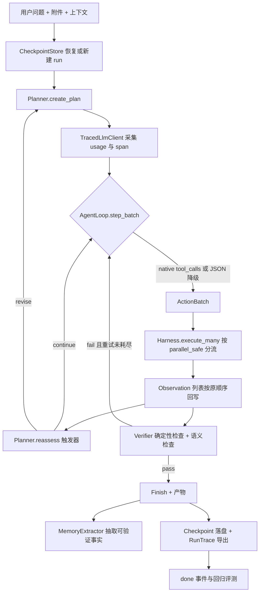
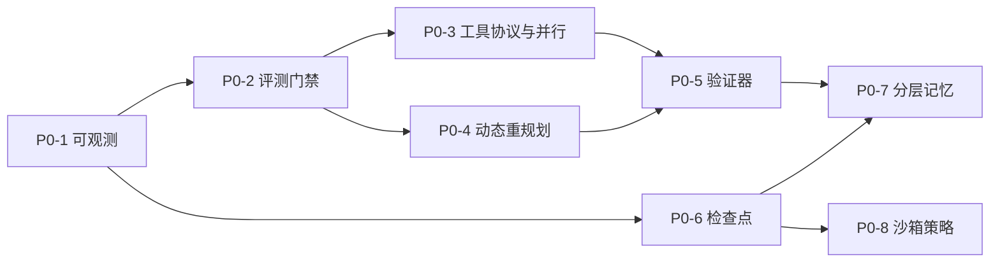

# DAAgent P0 能力优化改进方案

> 版本：v1.0（设计稿） | 日期：2026-11-08 | 状态：P0-1 已实现，其余项目待分阶段实施
> 适用范围：`data_analysis/` 统一 Agent 运行时与 `server/` 服务层
> 输入基线：`docs/Architecture.md`、`docs/Project.md`、`README.md`；主流能力基线参照附录 B
> 关联文档：本文只覆盖 P0（运行时基础设施）。P1（MCP/A2A、子代理、浏览器、SQL、多模态）与 P2（认证、多租户、队列、限流）另行规划。

---

## 0. 执行摘要

**核心判断**：DAAgent 已完成"单机、单用户、文件驱动"的数据分析闭环，P0 改造的目标不是更换框架或增加分析方法，而是补齐八项**智能体运行时基础设施**。改造后，系统应从"能跑完一次任务"升级为"能证明跑对了、出错能发现、中断能恢复、迭代有回归门禁"。

**第一原则：先建度量，再改行为。** 当前没有 trace、token 计量与离线评测（`server/*.py` 无 langsmith / opentelemetry / metrics 命中，`tests/` 全为确定性单元断言）。在这种情况下替换工具协议或加入重规划，无法判断改动是改善还是退化。因此 P0-1（可观测）与 P0-2（评测）必须作为阶段 A 前置门禁。

**不做什么**：不重写为 LangGraph，不引入赛题/业务固定模板，不把预定义方法论注入决策链，不在本轮做多租户或前端重构。理由见 §8。

### 阶段划分速览

| 阶段 | 内容 | 依赖 | 出口门禁 |
| --- | --- | --- | --- |
| A 度量地基 | P0-1 可观测与成本计量、P0-2 离线评测与回归门禁 | 无 | 评测集可运行，基线指标入库，后续所有改动须附 diff |
| B 决策与执行 | P0-3 原生工具调用与并行、P0-4 动态重规划 | A | 决策轮数下降且评测集通过率不退化 |
| C 可信闭环 | P0-5 独立验证器、P0-6 检查点与续跑 | A、B | 错误结论可拦截，进程重启可续跑 |
| D 记忆与安全 | P0-7 分层记忆、P0-8 沙箱与工具策略 | C | 记忆不污染事实，工具出网与命令可审计 |

---

## 1. 现状基线与约束

### 1.1 必须先统一的架构事实

下列事实经源码逐项核对，后续设计与评审均以 `data_analysis/` 当前实现为准，不采用历史文档或旧日志中的口径。

| 常见认知 | 源码实况 | 证据 |
| --- | --- | --- |
| 编排基于 LangGraph 状态图 | `pyproject.toml:8` 仍声明 `langgraph`，但全仓 `.py` 无 import；实际是手写生成器 `iter_plan_graph` 的 Plan-and-Execute + 串行 ReAct | `data_analysis/agent/graph.py:151-283` |
| SEARCH / CANDIDATE / CODE_REPAIR / VALIDATION 四类阻塞预算 | 当前源码无该枚举，名称仅见于 `server/uvicorn.out` 遗留日志（指向旧 MMAgent）；实际为全局决策轮数 160、单 Todo 30 步、重规划 ≤2、失败熔断 3，以及字符/token/超时上限 | `server/main.py:151-154`、`data_analysis/agent/state.py:683-692`、`data_analysis/context/rolling_memory.py:12-24` |
| 三道质量门 G0/GQ/GF、异步任务队列 | 旧版 PRD 文案，服务端无实现；`server/runs.py` 已删除，旧接口统一 410 | `docs/PRD.md:84,137`、`server/main.py:2707-2711` |
| 文档与代码一致 | 存在偏差：`docs/Architecture.md:126` 称"有 Tavily 密钥才注册联网工具"，实际 `registry.py:511-536` 无条件注册；`AGENTS.md:31` 引用已删除文件 | `data_analysis/tools/registry.py:511`、`data_analysis/tools/web_search.py:44-45` |

### 1.2 设计约束

1. **通用性优先**：所有改造面向通用数据分析任务，禁止为单一赛题、单一数据集或单一业务口径定制分支（`AGENTS.md` 第 1 条）。
2. **LLM-only 决策**：不预设问题分类、不注入固定方法集、不硬编码"什么情况该重规划"的业务规则；框架只提供触发时机与事件，判断交给 LLM（`AGENTS.md` 第 2 条）。
3. **事实来自工具**：记忆、规划、验证器都不得替代工具执行；任何数值、字段、结论必须可回溯到 `Observation` 或产物。
4. **最小侵入**：优先用装饰器/适配器扩展现有接口，保留 `AgentLoop.step()`、`Harness.execute()`、`iter_plan_graph()` 的既有语义与旧测试；新增能力走新入口。
5. **依赖隔离**：新增依赖写入 `pyproject.toml` 并装在项目自身虚拟环境，禁止 editable 外链；不得引入需要 API key 才能运行的测试。
6. **代码规范**：Python 3.11+、四空格、`snake_case`、`PascalCase` 类名、类型注解、Google 风格 docstring；**所有代码注释使用中文**；提示词集中放 `data_analysis/prompts/`。
7. **超参数注释**：所有新增配置项必须在配置表与代码注释中说明作用、默认值、调整影响（见 §6）。
8. **测试纪律**：每个改动先写 1-2 个针对性测试，跑 focused test → 相关 suite → 前端改动后 `npm run build`；每个缺陷修复补回归测试。
9. **提示词边界**：新增提示词独立成文件（`prompts/verifier.md`、`prompts/memory_extract.md`），不把长文本内嵌进代码。

### 1.3 P0 缺口全景

| 原清单项 | 本文档编号 | 能力 | 现状证据 | 主要影响 |
| --- | --- | --- | --- | --- |
| 6 | P0-1 | 可观测性与成本计量 | `server/*.py` 无 trace/metrics；`Observation` 仅 `duration_ms`（`state.py:132-159`、`harness.py:54,100`） | 无法定位死循环、无法归因成本、无法审计 |
| 7 | P0-2 | 评测与回归门禁 | 无 eval/benchmark；无 `chat/stream` 端到端测试 | 改动无安全网，回归靠人工看 demo |
| 1 | P0-3 | 原生 function calling 与并行工具 | 文本 JSON 协议且"仅可选择其中之一"（`loop.py:289-302`）；`Action` 单 `tool_name`（`:93-101`）；`llm.py:86-103` 无 `bind_tools` | 工具调用成功率受格式约束、长任务轮数与延迟偏高 |
| 2 | P0-4 | 动态重规划 | 计划只生成一次（`graph.py:176`）；Planner 看不到 observations（`planner.py:203-250`）；重规划仅失败触发且 ≤2（`:243-246`） | 计划与证据脱节，中途发现数据不符时无法改道 |
| 3 | P0-5 | 独立验证器 / 反思 | 校验散在提示词 `prompts/system.md:42,107`、退出码 `harness.py:102-112`、`Observation` 模型约束 | 错误随步数复利，交付物无代码级复核 |
| 4 | P0-6 | checkpoint / 崩溃恢复 | 运行注册表为内存 dict（`main.py:174`）；重启重连 404（`:2581`）；取消即终止（`:2250-2272`） | 长任务不可暂停/恢复，HITL 只是进程内暂停 |
| 5 | P0-7 | 跨会话长期记忆 | 仅会话内滚动摘要 `context/rolling_memory.py:146-211` 与轨迹 `state.py:302-515`；Memory Engine 属规划文案 | 指标口径、已验证方法每次重来 |
| 8 | P0-8 | OS 级沙箱与工具策略 | `runtime/sandbox.py:1` 自述"演示实现"；4 个 `run_in_process` 工具（`registry.py:485,511,742,777`）；终端任意命令靠人工批准；`skills/runtime.py:139-140` 因无网络隔离禁用 network | 提示注入与数据外泄缺少结构性防线 |

---

## 2. 目标架构

### 2.1 改造前后流程对比

改造前（当前 `iter_plan_graph`）：

```text
Planner.create_plan（一次，看不到工具结果）
  → 串行取一个 Todo → _todo_state（清空 observations）
  → AgentLoop.step（单个文本 JSON 决策）
  → Harness.execute（单个工具，串行）
  → Observation → 下一轮（仅格式纠错，无语义验证）
  → 失败才重规划（≤2）→ _final_state → Finish → 落库
```

改造后（保持三段式骨架，插入四个横切层）：



关键点：**骨架不变**（Plan → Todo → Finish），新增能力以横切层注入，避免推倒重写。`TracedLlmClient`、`CheckpointStore`、`Verifier`、`MemoryStore` 均为可关闭的适配层，默认行为与现状一致，按阶段灰度启用。

### 2.2 新增模块与职责

| 模块 | 建议文件 | 职责 | 阶段 |
| --- | --- | --- | --- |
| 可观测 | `data_analysis/observability/trace.py` | `RunTrace` / `Span` 数据模型，span 树与父子关系 | A |
| 用量采集 | `data_analysis/observability/usage.py` | 从 LangChain `AIMessage.usage_metadata` 提取 token，兼容缺失 | A |
| LLM 装饰器 | `data_analysis/observability/client.py` | `TracedLlmClient` 实现 `LlmClient` Protocol，包装原客户端 | A |
| 导出 | `data_analysis/observability/exporter.py` | JSONL + SQLite 双写，不发起网络请求 | A |
| 评测集 | `tests/evals/dataset/*.jsonl` | 20-30 条标准任务与期望轨迹 | A |
| 评测执行器 | `tests/evals/run_eval.py` | mock LLM + 真实工具，产出指标与基线 diff | A |
| 决策批量化 | `data_analysis/agent/decision.py` | `ActionBatch`、`step_batch()`、tool_calls 解析与 JSON 降级 | B |
| 重规划 | `data_analysis/agent/planner.py` 扩展 | `reassess()`、`recent_observations` 上下文、通用计划合并 | B |
| 验证器 | `data_analysis/agent/verifier.py` + `prompts/verifier.md` | 确定性检查 + 语义检查，结构化 `Verification` | C |
| 检查点 | `data_analysis/runtime/checkpoint.py` | `CheckpointStore` 接口与 SQLite 实现、快照序列化 | C |
| 记忆 | `data_analysis/memory/` | `models.py` / `extractor.py` / `store.py` / `retriever.py` | D |
| 工具策略 | `data_analysis/runtime/policy.py` + `terminal_policy.yaml` | 工具风险元数据、域名白名单、命令策略、审计 | D |

### 2.3 关键数据结构（示意，注释说明字段作用）

```python
class Span(BaseModel):
    """一个可嵌套的执行片段；用于还原 Agent 的决策树而非单次请求。"""
    model_config = ConfigDict(extra="forbid")

    span_id: str                      # 片段唯一标识，用于父子关联
    parent_span_id: str | None = None  # 顶层 run 为空；Todo/LLM/工具片段指向所属 Todo
    run_id: str                       # 一次 Agent 运行，跨 Todo 共享
    kind: Literal["run", "plan", "todo", "llm", "tool", "skill", "approval", "verify"]
    name: str                         # 工具名、模型名或事件名，用于聚合统计
    started_at: str                   # ISO 时间，用于计算耗时与 p95
    duration_ms: int                  # 片段耗时；工具侧复用 Observation.duration_ms
    input_tokens: int | None = None   # 供应商未返回 usage 时保持 None，禁止填 0 冒充
    output_tokens: int | None = None
    status: Literal["ok", "error", "cancelled"]
    error_type: str | None = None     # 仅记录类型，不记录密钥或大段输出


class ActionBatch(BaseModel):
    """一次决策可携带多个只读工具调用；保持顺序以支持确定性回放。"""
    model_config = ConfigDict(extra="forbid")

    thought: str                      # 沿用现有可公开工作记录，不改变前端展示语义
    actions: list[Action] = Field(default_factory=list, min_length=1)
```

---

## 3. 八项改造详述

### P0-1 可观测性与成本计量

**现状**：`LlmClient` Protocol 仅 `invoke(messages) -> Any`（`loop.py:83-86`）；`invoke_llm_with_public_progress`（`loop.py:575`）返回文本，未采集 `usage_metadata`；`Observation`（`state.py:132-159`）只有 `tool_name/success/result/error/duration_ms`；`done` 事件已保存 `agent_trace`（`main.py:2537`）但那是业务轨迹，无 span、无 trace_id。

**目标**：一次运行可导出完整 span 树；每次 LLM 与工具调用有 token/耗时/状态；成本可归因到 run/Todo/工具；无 usage 数据时明确标记 `unknown` 而非零值。

**设计**：

1. `TracedLlmClient` 实现与 `LlmClient` 相同的 `invoke` 签名，内部调用原 `ChatOpenAI`，从 `AIMessage.usage_metadata`（缺失时回退 `response_metadata["token_usage"]`）提取 token，注册为 `llm` span。**`AgentLoop` 与 `Planner` 无需改动**，只在 `server/main.py:2165-2179` 构造处替换客户端实例。
2. `Harness.execute`（`harness.py:45-128`）在返回 `Observation` 前注册 `tool` span；`Observation` 增加可选字段 `span_id`、`input_tokens`、`output_tokens`、`cost_estimate`，`extra="forbid"` 下需同步改模型。
3. `graph.py` 的事件节点（`PlanCreated` / `TodoStarted` / `TodoCompleted` / `TodoFailed`，`:42-73`）产生 `plan` / `todo` span；审批等待（`main.py:2386-2457`）产生 `approval` span。
4. 导出双写：本地 JSONL（便于人工排查）与 `agent.db` 新表 `agent_spans`（便于聚合）。不引入外部 SaaS、不发起额外网络调用。
5. `done` 事件增加 `trace_id`、`usage_summary`（`main.py:2545-2555`），前端可按需展示，本阶段不做 UI 改版。

**改动文件**：新增 `data_analysis/observability/*`；修改 `data_analysis/agent/state.py`、`data_analysis/runtime/harness.py`、`data_analysis/agent/graph.py`、`server/main.py`、`server/store.py`。

**验收标准**：构造一次含≥3 个 Todo、≥5 次工具调用的运行，导出 span 树满足：父子关系完整、LLM span 数 = 决策次数、工具 span 数 = `Observation` 数、token 总量与供应商返回值一致（供应商缺失时字段为 `null`）、`run_id` 贯穿全树。

**回归测试**：`tests/unit/runtime/test_observability_usage.py`（mock 响应带/不带 `usage_metadata` 两种边界）；`tests/unit/test_observation_span_fields.py`（`Observation` schema 边界，符合 `AGENTS.md` 对异常输出的测试要求）。

**风险与回滚**：装饰器若改变 LLM 返回类型会破坏流式 `invoke_llm_with_public_progress`。回滚方式：构造处恢复原客户端，span 采集降级为仅工具侧；数据模型字段保持可选，旧事件可正常反序列化。

**P0-1 实施记录（2026-11-08）**：已接入 `invoke` 与 `stream` 透明装饰器，覆盖上下文压缩、规划、Todo、最终汇总及工具内部模型调用。真实模型请求（含规划和纠错）各有一个 LLM span，不直接等同于 `RunBudget.iterations`。工具执行、重复拦截、技能与审批有状态记录；取消时关闭活动节点并拒绝迟到更新。`verify` 类型已预留，实际节点待 P0-5 实现，不在此阶段伪造验证记录。

片段结束后双写 `.runtime/agent_traces/<run_id>.jsonl` 与 `agent.db.agent_spans`，`done` 及助手历史消息保存 `trace_id`、`usage_summary`。汇总含已知小计和未知调用数，缺失时总量为 `null`；未提供单价不估算金额。新增四组计量、schema、调度器和接口测试，包含 3 个 Todo / 5 次工具调用 / 10 次模型请求的跨线程验收，以及批准、拒绝、超时、取消和双写故障覆盖。实现不包含 P0-2 评测门禁或 P0-5 验证器。

**验证结果**：P0-1 新增测试及相关回归通过；排除已在 Git HEAD 存储模块上复现的 `test_discussion_remembers_selected_model_config`（会话缺少 `reasoning_effort`），并排除单独运行仍在 `TestClient` 等待中阻塞的 `test_process_exception_guard.py` 后，单元测试为 **216 passed，1 deselected**。这两项验证限制保留记录，本次未修改对应会话返回或异常守卫逻辑。无前端改动。

---

### P0-2 离线评测与回归门禁

**现状**：`pyproject.toml:44-47` 仅配置 `tests`；`tests/` 下 153 个 `test_` 函数全部为确定性单元断言（已按 `^\s*(async )?def test_` 逐文件核对）；`POST /api/agent/chat/stream`（`main.py:1963`）无端到端流式测试。

**目标**：`pytest -m eval` 可在无 API key、无网络环境下运行；产出结构化指标与基线 diff；指标退化时 CI 失败。

**设计**：

1. **评测集** `tests/evals/dataset/*.jsonl`，每行一条：`{case_id, user_query, fixtures, scripted_decisions, expectations}`。`fixtures` 指向 `tests/evals/fixtures/` 下的小型 CSV/Excel/Markdown；`scripted_decisions` 是 mock LLM 的确定性决策序列，**不调用真实模型**。
2. 覆盖 7 类场景，每类 3-5 条，共 20-30 条：简单问答（直接 Finish）、单表画像、多表合并与口径冲突、脏数据（缺失/重复/异常值）、故障注入（工具连续失败触发熔断与重规划）、产物生成（`write_artifact` + 图表）、知识库检索与引用。
3. **执行器** `run_eval.py` 复用真实 `ToolRegistry` / `Harness` / `iter_plan_graph`，在临时目录运行；从 P0-1 的 `RunTrace` 提取轨迹。
4. **指标定义**：

| 指标 | 定义 | 采集来源 |
| --- | --- | --- |
| `task_success_rate` | 产出 `Finish` 且满足 `expectations` 的比例 | 事件流 |
| `evidence_grounded_rate` | 结论中出现的数值可在 `Observation` 或产物中找到来源的比例 | 确定性比对，不调 LLM |
| `avg_decisions` / `p95_decisions` | 决策轮数均值与 95 分位 | `RunBudget.iterations` |
| `tool_error_rate` | `success=False` 的 `Observation` 占比 | span |
| `replan_count` | 失败重规划 + 自适应重规划次数 | span |
| `artifact_validity` | 声明的产物存在、可解析、大小合理 | 文件校验 |
| `verifier_catch_rate` | 错误结论被拦截比例（P0-5 上线后启用） | `Verification` |

5. **门禁**：`tests/evals/baseline.json` 记录各指标基线；`run_eval.py --check` 在 `task_success_rate`、`evidence_grounded_rate` 低于阈值或 `avg_decisions` 超出上限时以非零码退出。`pyproject.toml` 增加 `markers = ["eval: ..."]`。

**改动文件**：新增 `tests/evals/*`；修改 `pyproject.toml`（marker 与超参数注释）。

**验收标准**：`pytest -m eval` 全绿且耗时可控（全部用例 mock LLM）；故意把某个工具描述改坏能触发门禁失败并输出可读 diff；无 API key 环境下可完整运行。

**回归测试**：`tests/unit/test_eval_runner.py`（评测执行器自身的异常输入：缺失 fixture、脚本决策耗尽、空期望）。

**风险与回滚**：评测集若绑定具体数据文件名，会违反通用性约束。规避：用例描述任务目标而非固定方法，断言只校验"结论可回溯""产物有效"，不校验特定算法。

---

### P0-3 原生工具调用与并行执行

**现状**：`build_messages`（`loop.py:279-302`）把工具 JSON 拼进 system prompt；`Action` 单 `tool_name`；`step()` 返回单个 `Decision`；`graph.py:199-234` 顺序 `decision → 单个 observation → 下一轮`。

**目标**：支持供应商原生 `tool_calls`、单步多工具、只读工具并行；JSON 协议保留为自动降级；决策轮数与端到端延迟下降。

**设计**：

1. **协议适配**：`create_llm`（`llm.py:14-103`）保持返回普通客户端；新增 `NativeToolClient`（`data_analysis/agent/decision.py`）调用 `ChatOpenAI.bind_tools(schema_list)`，把 `AIMessage.tool_calls` 解析为 `ActionBatch`。schema 直接从 `registry.specs()` 的 `ToolSpec.parameters`（`registry.py:79-102`，已保证合法 JSON）生成，禁止手写第二份 schema。
2. **兼容性**：`AgentLoop.step()` 保留原语义（返回单个 `Decision`），新增 `step_batch()` 返回 `ActionBatch | Finish`；`step()` 实现为 `step_batch()` 的单元素投影，旧测试与 `iter_graph`（`graph.py:76-120`）不受影响。
3. **并行策略**：`ToolSpec` 增加 `mutating: bool = False`、`parallel_safe: bool = True`、`network: bool = False`、`risk` 与 `timeout_seconds`。注册时标注：`profile_data`、`inspect_data_rows`、`read_*`、`search_workspace_text`、`search_web`、`search_knowledge_base` 为只读可并行；`execute_python`、`write_artifact`、`write_workspace_file`、`edit_workspace_file`、`run_terminal_command` 为 `mutating=True`，**一律串行**。`registry.py:826` 的终端工具同时 `parallel_safe=False`。
4. **执行**：`Harness.execute_many(actions)` 用 `ThreadPoolExecutor(max_workers=max_parallel_tools)` 并行只读工具；结果**按输入顺序**组装 `Observation` 列表回写，保证事件回放与 `WorkTrajectory.observe_tool`（`state.py:458`）的确定性。含任一 `mutating` 工具时整批退化为串行。
5. **降级链**：`tool_mode=auto` 时先探测供应商能力，失败或解析异常自动回退 JSON 协议并记 `fallback` span；`decision_retries`（`loop.py:221-258`）继续只负责格式纠错，语义错误交给下一轮观察。
6. **预算语义**：一个 `ActionBatch` 记为**一次决策**（`RunBudget.iterations += 1`），但每个工具各自记一次 `Observation` 与 span，避免并行放大预算或掩盖失败。

**改动文件**：新增 `data_analysis/agent/decision.py`；修改 `data_analysis/tools/registry.py`、`data_analysis/agent/loop.py`、`data_analysis/agent/graph.py`、`data_analysis/runtime/harness.py`、`server/main.py:2108-2124`。

**验收标准**：评测集上 `avg_decisions` 下降 ≥20% 且 `task_success_rate` 不退化；`mutating` 工具从不出现在并行批次；同一批并行结果顺序与 `actions` 顺序一致；`tool_mode=json` 时全部旧测试通过。

**回归测试**：`tests/unit/agents/test_action_batch.py`（tool_calls 畸形输出、未知工具名、混合 mutating/readonly 批次）；`tests/unit/runtime/test_parallel_order.py`。

**风险与回滚**：并行放大文件/网络竞争、模型提交相互依赖的工具。缓解：`parallel_safe` 白名单、顺序回写、默认 `max_parallel_tools=4`；一键切回 `tool_mode=json` 即为完整回滚。

---

### P0-4 动态重规划与观察可见

**现状**：`Planner.build_messages` 的 context（`planner.py:203-250`）无 `observations`；计划仅 `create_plan` 一次（`graph.py:176`）；`create_recovery_plan`（`planner.py:131-183`）只在失败时调用；`_todo_state`（`graph.py:463-492`）为每个 Todo 清空 observations，跨 Todo 只靠 `result_summary`（单条 2000 字符、合计 16000，`:431-460`）传递。

**目标**：Planner 能看到压缩后的工具观察；成功路径上可按证据充分性改写剩余计划；已完成 Todo 的产物与结果不丢失；不因频繁重规划放大成本。

**设计**：

1. **上下文打通**：`Planner.build_messages` 的 context 增加 `recent_observations`（复用 `loop.py:472-516` 的 `_project_observations` 投影，不重复实现裁剪逻辑）、`completed_todos`、`available_artifacts` 摘要。字符预算沿用 `planner.py:30-41` 的常量体系。
2. **触发器（框架只提供时机，判断交给 LLM）**：每个 Todo 完成后、每 `replan_check_interval` 次决策、熔断/新证据与计划假设冲突时，调用 `Planner.reassess(state, plan, trigger) -> PlanDecision`，输出 `continue | revise | finish_early` 与理由。`finish_early` 用于证据已充分、剩余 Todo 冗余的场景。
3. **计划合并**：把 `_merge_recovery_plan`（`graph.py:375-415`）泛化为 `_merge_revised_plan`，保留已结束 Todo、重映射 id 与依赖、继承 `work_trajectory` 与产物引用；复用 `AnalysisPlan.validate_dependencies`（`state.py:82-112`）做无环校验。
4. **预算拆分**：`replan_count` 拆为 `failure_replans`（沿用上限 2）与 `adaptive_replans`（上限 2），两者独立计数并写入 span，便于评测归因。
5. **成本约束**：`reassess` 默认在 Todo 边界触发而非每步；`continue` 时不产生新 LLM 决策轮次之外的额外工具调用；可用较短的提示模板与低 `max_tokens`。

**改动文件**：`data_analysis/agent/planner.py`、`data_analysis/agent/graph.py`、`data_analysis/prompts/planner.md`。

**验收标准**：评测集"数据列与计划假设不符"用例中，Agent 改写剩余 Todo 且已完成 Todo 的 `result_summary` 与产物仍在；普通用例的 `adaptive_replans` 均值为 0（不产生无谓重规划）；`finish_early` 不跳过 P0-5 验证器。

**回归测试**：`tests/unit/agents/test_reassess_plan.py`（revise 后依赖无环、id 唯一、已完成 Todo 保留）；`tests/unit/agents/test_planner_observations.py`（观察投影超长截断）。

**风险与回滚**：重规划导致循环或预算膨胀。缓解：双上限 + `reassess` 只在触发点调用 + span 监控；开关 `adaptive_replan_enabled=false` 即回到现状。

---

### P0-5 独立验证器 / 反思闭环

**现状**：`prompts/planner.md:36` 要求最后一个 Todo 核验交付物，但仅为提示词；代码级校验只有终端退出码（`harness.py:102-112`）与 `Observation` 成功/错误互斥（`state.py:152-159`）；无 critic / verifier 节点。

**目标**：`Finish` 前执行代码级确定性检查 + 语义检查；失败可回灌观察并有限次修订；无法通过时显式披露而非静默通过。

**设计**：

1. 新增 `Verifier.verify(state, plan, answer) -> Verification`（`data_analysis/agent/verifier.py`），字段：`status: pass|fail|uncertain`、`issues: list[VerificationIssue]`、`checked_artifacts`。
2. **确定性检查（不调 LLM）**：`answer` 中引用的相对路径必须存在于 `available_artifacts`；声明的产物文件存在、非空、可解析（CSV/JSON/图片头校验）；生成的 `.py` 产物通过 `compile()` 静态语法检查；结论中的数值型断言能在 `Observation.result` 或产物内容中定位来源；所有 Todo 非 `failed`。
3. **语义检查（LLM，独立提示词 `prompts/verifier.md`）**：结论是否回答 `state.user_query`、是否覆盖 `AnalysisPlan.todos`、是否存在与观察冲突的断言。低温度、结构化 JSON 输出，解析失败按 `uncertain` 处理，不阻断交付。
4. **挂接位置**：`graph.py:258-282` 的最终汇总循环内，`Finish` 写消息之前（`:264-268`）。`fail` 时把 `issues` 转成 `Observation` 回灌 `final_state`，允许 `max_verify_retries=1` 次修订；仍失败则 `status=uncertain`，在 `done` 事件与答案中显式标注未通过项。
5. **事件**：新增 `VerificationCompleted`（与现有 `PlanGraphEvent` 联合类型对齐，`graph.py:42-73`），前端可选择展示，本阶段不强制改 UI。

**改动文件**：新增 `data_analysis/agent/verifier.py`、`data_analysis/prompts/verifier.md`；修改 `data_analysis/agent/graph.py`、`server/main.py:2545-2555`。

**验收标准**：评测集"故意生成错误结论 / 引用不存在产物"用例拦截率 ≥80%；正常用例因验证器新增的 LLM 调用 ≤1 次；`uncertain` 状态在 `done` 事件中可见；`Finish` 事件结构与旧版兼容。

**回归测试**：`tests/unit/agents/test_verifier.py`（畸形 LLM 输出、缺失产物、数值无来源）；`tests/unit/test_verification_event.py`。

**风险与回滚**：语义检查误判导致正常任务反复修订。缓解：`max_verify_retries=1`、`uncertain` 不阻断、开关 `verifier_enabled=false`；确定性检查始终开启，不受开关影响。

---

### P0-6 持久化执行与检查点

**现状**：`AgentChatRun` 与 `_agent_chat_runs` 纯内存（`main.py:160-174`）；事件可回放但服务重启后 `reconnect_agent_chat_run`（`:2576-2586`）返回 404；`AgentState` 只在请求内存；`_pending_agent_commands`（`:155`）亦为内存；取消后保存"任务已终止"并结束（`:2250-2272`）。

**目标**：状态按事件落盘；进程崩溃/重启后可从最近检查点续跑；审批等待可恢复；取消可选择"暂停"而非终止。

**设计**：

1. **存储**：`server/store.py` 的同库新增 `agent_checkpoints` 表（`run_id, seq, kind, state_json, created_at`，索引 `(run_id, seq)`）；`CheckpointStore` 接口放 `data_analysis/runtime/checkpoint.py`，SQLite 实现放 `server/` 侧适配，决策层不持有文件系统权限（符合 `docs/Architecture.md:78-85` 依赖规则）。
2. **快照内容**：`AgentState.model_dump(mode="json")` + `AnalysisPlan` + `current_todo_id` + 两类 replan 计数 + `trace_id` + 当前 `RepeatGuard` / `FailureTracker` 指纹摘要。**安全约束**：不写入明文密钥；`authorized_paths`、`output_dir` 用相对化或引用 ID 保存，恢复时由服务端按会话重新授权。
3. **共享引用修正**：`RunBudget` 当前按引用在 Todo 间共享（`state.py:683-692`、`graph.py:488`）。序列化后恢复必须重建**单一实例**并重新绑定到所有子状态，否则总预算被放大到「Todo 数 × 上限」。这是本项最易出错处，需专门测试。
4. **落盘时机**：`PlanCreated`、`TodoStarted/Completed/Failed`、每个 `Observation`、**审批事件下发前**（`main.py:2386-2419`，先落盘再暂停）、`Finish`。采用「每 `checkpoint_full_interval` 步全量 + 其间增量 observation」以控制写放大。
5. **恢复入口**：`iter_plan_graph(..., resume_from=Checkpoint)` 重建 state/plan 并从 `current_todo_id` 继续；`_todo_state`（`graph.py:463-492`）改为可从快照中的 todo observations 恢复。服务端新增 `POST /api/agent/chat/runs/{run_id}/resume`；`reconnect_agent_chat_run` 在内存未命中时查库并返回 `resumable: true` 与 `checkpoint_seq`。
6. **审批恢复**：待审批的 `approval_id` 落盘，恢复时重建 `_pending_agent_commands` future；重放时沿用 `_replay_agent_chat_run`（`main.py:177-195`）已有的 `approval_id` 过滤逻辑。
7. **取消语义**：默认保持现行为；开关 `pause_on_cancel=true` 时落 `paused` 快照而不是终止。`AGENT_RUNTIME_MAX_AGE_SECONDS`（`main.py:148`）的清理策略需同步覆盖过期检查点。

**改动文件**：新增 `data_analysis/runtime/checkpoint.py`、`server/checkpoint_store.py`；修改 `data_analysis/agent/graph.py`、`server/store.py`、`server/main.py`（启动装配、审批、重连、取消、done）。

**验收标准**：运行中途终止进程并重启，可从最近检查点续跑，已生成产物不重复生成；审批等待中重启可继续批准；`RunBudget.iterations` 恢复后既不重置也不重复计数；未完成 run 在重启后可枚举。

**回归测试**：`tests/unit/runtime/test_checkpoint_roundtrip.py`（含 `RunBudget` 共享引用）；`tests/unit/test_resume_from_approval.py`（mock LLM 与审批）。

**风险与回滚**：快照含绝对路径或过期授权导致越权，`extra="forbid"` 下模型字段新增引发旧快照反序列化失败。缓解：快照带 `schema_version`，不兼容时降级为"不可续跑"并明确提示；开关 `checkpoint_enabled=false` 回到纯内存行为。

---

### P0-7 分层记忆

**现状**：会话内滚动压缩 `context/rolling_memory.py:146-211`、结构化轨迹 `state.py:302-515`、服务端从会话重建上下文（`main.py:2056-2081`）；`docs/data_analysis_power.md:23-31` 的 Memory Engine / Method Learner 为规划文案，无代码。

**目标**：跨会话复用**可验证的事实**（指标口径、字段含义、已验证方法、产物用途）；记忆冲突时以本次工具观察为准；默认关闭、可灰度、可删除。

**设计**：

1. `MemoryRecord`（`data_analysis/memory/models.py`）：`kind: fact|method|artifact_summary|preference`、`content`、`source_run_id`、`project_id?`、`session_id?`、`created_at`、`content_hash`、`embedding?`。
2. `MemoryExtractor`（`extractor.py` + `prompts/memory_extract.md`）：任务结束后从 `WorkTrajectory` 与 `Finish` 抽取事实，**禁止抽取主观结论或未经验证的数值**；按 `content_hash` 确定性去重；低温度 LLM，失败则跳过不阻断交付。
3. `MemoryStore`（`store.py`）：复用 `KnowledgeBase/embedding.py` 的本地 BGE + Qdrant 基础设施，元数据落 `agent_memories` 表；按 `project_id` / `session_id` 作用域过滤，避免跨项目串味。
4. `MemoryRetriever`（`retriever.py`）：构造 `AgentState.memory_summary` 时检索 `memory_top_k` 条，受 `memory_char_budget` 限制；每条附 `source_run_id` 与来源标注，注入 `session_memory` 字段。
5. **事实优先级**（写入 `prompts/system.md`）：记忆只是线索，指标口径与数据事实一律以本次 `Observation` / 产物为准；发现冲突时显式说明并弃用记忆，不得据此跳过必要工具调用。

**改动文件**：新增 `data_analysis/memory/*`、`data_analysis/prompts/memory_extract.md`；修改 `server/main.py:2056-2081`、`data_analysis/prompts/system.md`、`server/store.py`。

**验收标准**：评测集"跨会话复用口径"用例命中记忆且仍执行数据读取；"记忆与新数据冲突"用例结论以新观察为准；关闭记忆时行为与现状完全一致；记忆可按 `source_run_id` 删除。

**回归测试**：`tests/unit/test_memory_extractor.py`（LLM 输出畸形、重复内容、空轨迹）；`tests/unit/test_memory_scope.py`（跨项目隔离）。

**风险与回滚**：记忆污染、嵌入服务不可用。缓解：默认 `memory_enabled=false`、TTL、确定性去重、检索失败静默降级为无记忆。

---

### P0-8 沙箱与工具策略

**现状**：`sandbox.py:1` 自述"演示实现"；4 个工具 `run_in_process` 绕过子进程（`registry.py:485,511,742,777`）；`terminal_tools.py:245-252` 完整继承 `os.environ`、无命令白名单；`_python_code_runner.py:150-229` 用 `unittest.mock.patch` 拦写，可被 ctypes/socket 绕过；`skills/runtime.py:139-140` 因"无可验证网络隔离"直接拒绝 `network: true`；`docs/Architecture.md:180` 已承认非 OS 级强沙箱。

**目标**：统一的工具策略元数据与审计；消除主进程逃逸；出网受域名白名单约束；终端命令可回放审计。明确边界：Windows 单机环境下**不引入 OS 级沙箱**，不宣称等价于容器隔离。

**设计**：

1. **策略元数据**：P0-3 已在 `ToolSpec` 增加 `network/mutating/risk/timeout_seconds`，本项补 `NetworkPolicy`（`runtime/policy.py` + `network_allowlist.yaml`）与 `terminal_policy.yaml`（命令白名单/黑名单、环境变量裁剪）。`Harness.execute`（`harness.py:45-128`）改为按策略执行，替换硬编码的 `TERMINAL_TOOL_NAMES` 判断（`:56-64`）。
2. **主进程逃逸治理**：将 `search_web`、`search_knowledge_base`、两个视觉工具迁至 `SubprocessSandbox` 或专用 worker。注意 `RegisteredTool.context` 需为可 JSON 序列化（`:119-123`），因此 worker 侧用 `secret_ref` 引用而非明文密钥，由 worker 从服务端配置解析。知识库 embedding 模型改为进程内单例（`functools.lru_cache`），顺带解决 `knowledge_tools.py:52-55` 未传 `model` 导致每次重载、阻塞主进程的问题。
3. **终端**：环境变量裁剪（剔除密钥变量）、命令策略校验、逐条人工批准保留；每次批准与执行写入审计表（关联 `run_id`、`trace_id`、`approval_id`），与 P0-6 的审批快照一致。
4. **动态代码**：`code_tools.py` 执行前做 `ast.parse` 静态扫描，拒绝 `ctypes`、`socket`、`subprocess` 等逃逸导入；保留现有写限制但明确文档说明其为应用层防护。
5. **出网**：`search_web` / MinerU / 未来 MCP 调用统一经 `NetworkPolicy`；白名单为空时默认拒绝出网（除显式配置项）。Skill 的 `network: true` 在策略就绪后可有条件放行，仍受限白名单。

**改动文件**：新增 `data_analysis/runtime/policy.py` 与两个 yaml；修改 `data_analysis/tools/registry.py`、`data_analysis/runtime/harness.py`、`data_analysis/tools/code_tools.py`、`data_analysis/tools/terminal_tools.py`、`data_analysis/skills/runtime.py`、`KnowledgeBase/embedding.py`、`server/main.py`。

**验收标准**：`run_in_process` 工具数降为 0 或全部经隔离 worker；子进程 env 不含任何 `apiKey`；白名单外的域名请求被拒绝并有 span 记录；终端命令可按 `run_id` 回放审计；`execute_python` 含 `ctypes` 导入的用例被静态扫描拦截。

**回归测试**：`tests/unit/runtime/test_network_policy.py`、`tests/unit/tools/test_terminal_env_scrub.py`。

**风险与回滚**：迁移 `run_in_process` 会触碰知识库与视觉链路，是 P0 中改动面最大的一项。缓解：分两步——先落策略元数据与审计（低风险、可独立上线），再迁进程隔离；每步保留 `legacy_in_process_tools=true` 开关。

---

## 4. 实施路线与门禁



依赖关系说明：P0-4 与 P0-5 都需要观察投影（`loop.py:472-516`）；P0-6 必须能序列化 P0-3 新增的 `ActionBatch`，故排在阶段 C；P0-7 的记忆抽取与 P0-8 的审计都依赖 P0-1 的 trace 与 P0-6 的检查点。

| 阶段 | 交付物 | 阶段门禁（全部满足才进入下一阶段） |
| --- | --- | --- |
| A | span 树导出、评测集 20-30 条、基线 JSON、CI marker | `pytest -m eval` 全绿；无 API key 可运行；基线指标入库 |
| B | `ActionBatch`、`Harness.execute_many`、`reassess()` | `avg_decisions` 下降 ≥20% 且 `task_success_rate` 不退化；JSON 降级路径测试全绿 |
| C | `Verifier`、`CheckpointStore`、resume 端点 | 错误结论拦截率 ≥80%；进程重启续跑通过；预算不重复计数 |
| D | 记忆模块、策略与审计 | 记忆冲突用例通过；密钥不进子进程 env；`run_in_process` 清零或隔离 |

每阶段内部执行顺序：写针对性测试 → 最小实现 → focused test → 相关 suite → 前端如有改动则 `npm run build` → 更新 `tests/evals/baseline.json` 与本文 §9 清单。

---

## 5. 评测体系设计

### 5.1 用例结构

```json
{
  "case_id": "multi_sheet_conflict",
  "user_query": "核对两张表的口径差异并说明结论依据",
  "fixtures": ["fixtures/sales_a.csv", "fixtures/sales_b.csv"],
  "scripted_decisions": ["plan", "profile", "inspect", "execute_python", "finish"],
  "expectations": {
    "must_finish": true,
    "must_call_tools": ["profile_data", "inspect_data_rows"],
    "must_produce_artifacts": true,
    "forbid_tools": [],
    "max_decisions": 20,
    "verifier_status": "pass"
  }
}
```

`scripted_decisions` 是 mock LLM 的确定性序列，覆盖正常路径、格式错误、未知工具、连续失败等边界；**禁止断言特定算法或特定业务口径**，以保持通用性。

### 5.2 CI 门禁阈值

| 指标 | 门禁条件 | 作用 |
| --- | --- | --- |
| `task_success_rate` | ≥ 基线 − 0 个百分点 | 任何改动不得降低任务完成率 |
| `evidence_grounded_rate` | ≥ 基线 | 防止"看起来对但无证据"的答案 |
| `avg_decisions` | ≤ 基线 × 1.10 | 防止重规划/验证器引入步数膨胀 |
| `tool_error_rate` | ≤ 基线 × 1.20 | 防止工具协议改造引入执行错误 |
| `artifact_validity` | = 100% | 声明产物必须真实可用 |

阈值集中在 `tests/evals/thresholds.json`，修改需评审；每个参数在文件内以中文注释说明作用与调整影响。

---

## 6. 配置项与超参数

所有新增配置统一在服务端设置与 `.env.example` 中登记；**每个超参数必须在代码注释与下表说明作用、默认值与调整影响**。

| 参数 | 默认值 | 作用 | 调整影响 |
| --- | --- | --- | --- |
| `LLM_STREAM_USAGE` | `auto` | 沿用客户端兼容策略；`true` 请求流式用量，`false` 禁用请求 | 支持的自定义端点设 `true` 可补齐用量；不支持时应设 `false`，缺失计量保留未知 |
| `AGENT_LLM_INPUT_COST_PER_MILLION` | 空 | 当前模型输入 token 的美元/百万单价；需与输出单价同时提供 | 调大提高估算，不影响决策；切换模型须同步调整，缺失或无效时成本为 `null` |
| `AGENT_LLM_OUTPUT_COST_PER_MILLION` | 空 | 当前模型输出 token 的美元/百万单价；需与输入单价同时提供 | 调大提高估算，不影响决策；缺失用量时仍为 `null`，不代表实际账单 |
| `AGENT_MAX_DECISIONS` | 160 | 整轮运行共享的决策轮数上限，含全部 Todo 与最终汇总（`main.py:153`） | 调大允许更复杂任务但放大成本与失控风险；调小会让长任务提前 `IterationLimitError` |
| `max_todo_steps` | 30 | 单个 Todo 的决策轮数上限（`graph.py:160`），防止一个 Todo 吃掉整轮预算 | 调小会更频繁触发失败重规划；调大削弱隔离效果 |
| `failure_replans` | 2 | 失败熔断触发的恢复规划次数上限（`graph.py:159`） | 与 `adaptive_replans` 独立计数，避免重规划无限循环 |
| `adaptive_replans` | 2 | 成功路径上依据证据改写计划的次数上限（P0-4 新增） | 调大提升长任务适应性，同时增加 LLM 调用与步数 |
| `replan_check_interval` | 3 | 每隔多少次决策触发一次 `reassess`（P0-4 新增） | 调小更灵敏但显著增加成本；设为 0 表示仅在 Todo 边界触发 |
| `tool_mode` | `auto` | `native` / `json` / `auto`，控制工具调用协议与降级策略（P0-3 新增） | `json` 是完整回滚路径；`auto` 在供应商不支持 tool_calls 时自动降级 |
| `max_parallel_tools` | 4 | 单批只读工具的最大并发数（P0-3 新增） | 调大降低延迟但放大外部搜索限流与内存压力；`mutating` 工具不受此值影响 |
| `verifier_enabled` | `true` | 是否启用语义验证器（P0-5 新增）；确定性检查始终开启 | 关闭后仅保留文件/引用/语法检查，成本下降但错误结论拦截率下降 |
| `max_verify_retries` | 1 | 验证失败后允许回灌观察并修订的次数（P0-5 新增） | 调大会提高修复率但可能造成循环；超出后按 `uncertain` 显式披露 |
| `checkpoint_enabled` | `true` | 是否按事件落盘状态快照（P0-6 新增） | 关闭后回到纯内存运行，失去崩溃恢复能力 |
| `checkpoint_full_interval` | 10 | 每多少次观察写一次全量快照，其间写增量（P0-6 新增） | 调小提升恢复精度但增加 SQLite 写放大；调大降低写入但恢复点更粗 |
| `pause_on_cancel` | `false` | 取消时落 `paused` 快照而非终止（P0-6 新增） | 开启后改变现有取消语义，需前端配合展示"可续跑" |
| `memory_enabled` | `false` | 是否启用跨会话记忆抽取与召回（P0-7 新增），默认灰度关闭 | 开启后增加一次抽取 LLM 调用与向量写入；污染风险由去重与 TTL 控制 |
| `memory_top_k` | 5 | 单次任务召回的记忆条数（P0-7 新增） | 调大提升复用率但挤压上下文预算，并增加冲突概率 |
| `memory_char_budget` | 3000 | 注入 `session_memory` 的记忆总字符上限（P0-7 新增） | 需与 `planner.py:30-41` 的历史字符预算一并核算 |
| `network_allowlist` | 空列表 | 允许出网的域名白名单（P0-8 新增） | 为空时默认拒绝出网；新增域名需评审，防止数据外泄 |
| `legacy_in_process_tools` | `true` | 是否保留 4 个主进程工具的旧执行路径（P0-8 新增） | 迁移期回滚开关，最终应设为 `false` |
| `eval_success_rate_threshold` | 基线值 | 评测门禁的任务完成率下限（P0-2 新增） | 只许调高不许调低，防止用降阈值掩盖退化 |

---

## 7. 风险登记与回滚

| 风险 | 概率 | 影响 | 缓解措施 | 回滚方式 |
| --- | --- | --- | --- | --- |
| 并行工具造成文件/网络竞态 | 中 | 结果不确定、产物覆盖 | `parallel_safe` 白名单、`mutating` 强制串行、顺序回写 | `tool_mode=json`、`max_parallel_tools=1` |
| 重规划循环或步数膨胀 | 中 | 成本失控、超时 | 双上限、仅触发点调用、`avg_decisions` 门禁 | `adaptive_replan_enabled=false` |
| 验证器误判阻断正常交付 | 中 | 任务失败率上升 | `uncertain` 不阻断、重试上限 1、确定性检查与语义检查分离 | `verifier_enabled=false` |
| 快照反序列化失败或引用丢失 | 高 | 续跑失败、预算被放大 | `schema_version`、`RunBudget` 单一实例重建、路径引用化 | `checkpoint_enabled=false` |
| 记忆污染结论 | 中 | 事实错误且难排查 | 默认关闭、只抽可验证事实、冲突以观察为准、按 run_id 可删 | `memory_enabled=false` |
| 工具迁移破坏知识库/视觉链路 | 中 | 检索或图片复核不可用 | 先策略后隔离、`legacy_in_process_tools` 开关、模型单例缓存 | 开关切回旧路径 |
| 文档与实现再次漂移 | 高 | 后续改造基于错误前提 | 每阶段同步更新 `docs/Architecture.md` 与本文 §9 | 以源码为准，文档修订不阻塞代码回滚 |

---

## 8. 边界：本次 P0 不做

1. **不重写为 LangGraph**。当前手写生成器（`graph.py:151-283`）流程可控、事件语义清晰；引入状态图会带来事件模型、测试与前端协议的全面迁移，收益主要在 checkpoint 与并行，而这两项本方案用自研轻量层即可覆盖。`pyproject.toml:8` 的 `langgraph` 依赖在本轮清理或明确标注为未使用，避免误导。
2. **不引入预定义方法论或赛题模板**。P0-4 的重规划触发点只是框架事件，判断仍由 LLM 做出。
3. **不做 P1 能力**：MCP / A2A、子代理委派、浏览器、SQL 直连、音频视频多模态。
4. **不做 P2 能力**：认证与多租户、任务队列、限流、API/SDK、国际化。但需注意：若按 `start.ps1:80` / `docs/deploy-windows-ecs.md` 以 `0.0.0.0` + 明文 HTTP 公网部署，`server/main.py:282` 无鉴权与 `:284-290` CORS 全开属于独立的高风险项，**应作为并行安全专项处理，不因 P0 未包含而推迟**。
5. **不做前端视觉改版**。新增事件（`VerificationCompleted`、`resumable`）先由后端输出，前端按最小改动接入。

---

## 9. 验收清单

- [x] A：`TracedLlmClient` 可在不改 `AgentLoop`/`Planner` 构造的前提下采集 usage
- [x] A（P0-1）：span 树覆盖 run/plan/todo/llm/tool/skill/approval；verify 类型预留，节点待 P0-5 接入
- [ ] A：`pytest -m eval` 无 API key、无网络可运行，含 ≥20 条用例
- [ ] A：基线指标与阈值文件入库，退化时 CI 非零退出
- [ ] B：`tool_calls` 与 JSON 双协议可用，`auto` 降级有 span 记录
- [ ] B：`mutating` 工具零并行、批量结果顺序确定
- [ ] B：`avg_decisions` 下降 ≥20% 且完成率不退化
- [ ] B：`reassess`  revise 后依赖无环、已完成 Todo 与产物保留
- [ ] C：错误结论拦截率 ≥80%，`uncertain` 在 `done` 中显式披露
- [ ] C：进程重启可从检查点续跑，`RunBudget` 不重复计数
- [ ] C：审批等待中重启可继续批准
- [ ] D：记忆冲突用例以本次观察为准，关闭记忆时行为不变
- [ ] D：`network_allowlist` 生效、子进程 env 无密钥、终端操作可审计
- [ ] 全程：`tests/` 新增测试均 mock LLM 与网络；前端改动后 `npm run build` 通过
- [ ] 全程：同步修订 `docs/Architecture.md`、`docs/PRD.md` 中与实现不符的描述

---

## 附录 A：源码锚点索引

| 主题 | 位置 |
| --- | --- |
| 主循环与事件 | `data_analysis/agent/graph.py:42-73, 151-283, 285-337, 375-415, 418-519` |
| 决策与工具协议 | `data_analysis/agent/loop.py:83-101, 149-259, 279-302, 472-516, 575` |
| 规划器 | `data_analysis/agent/planner.py:73-183, 185-256` |
| 状态与预算 | `data_analysis/agent/state.py:24-112, 132-159, 302-515, 683-717, 772-809` |
| 执行框架 | `data_analysis/runtime/harness.py:19-128`；`runtime/sandbox.py:52-216` |
| 工具注册 | `data_analysis/tools/registry.py:79-137, 313-842` |
| LLM 客户端 | `data_analysis/llm.py:14-103` |
| 上下文压缩 | `data_analysis/context/rolling_memory.py:12-24, 146-211` |
| 提示词 | `data_analysis/prompts/system.md`、`planner.md` |
| 服务装配与流式 | `server/main.py:148-215, 2056-2224, 2304-2457, 2505-2600` |
| 持久化 | `server/store.py:16-89` |
| 知识库检索 | `KnowledgeBase/main.py:55-126`；`data_analysis/tools/knowledge_tools.py:16-70` |
| 测试配置 | `pyproject.toml:44-47`；`tests/unit/test_data_agent_api.py` |

## 附录 B：主流能力基线参考

- Anthropic, *Building Effective Agents*：https://www.anthropic.com/engineering/building-effective-agents
- Anthropic, *Effective context engineering for AI agents*：https://www.anthropic.com/research/effective-context-engineering-for-ai-agents
- OpenAI Agents SDK（Handoffs、Tracing）：https://openai.github.io/openai-agents-python/
- OpenAI Responses API（内置工具与后台模式）：https://platform.openai.com/docs/guides/migrate-to-responses
- LangGraph Persistence / Checkpointer / `interrupt()`：https://docs.langchain.com/oss/python/langgraph/persistence
- OpenTelemetry GenAI 语义约定：https://github.com/open-telemetry/semantic-conventions-genai
- MCP 规范：https://modelcontextprotocol.io/specification/2025-06-18
- A2A 规范：https://a2a-protocol.org/v1.0.0/specification/
- Anthropic, *Claude Code Sandboxing*：https://www.anthropic.com/engineering/claude-code-sandboxing
- OpenEvals（轨迹评测）：https://github.com/langchain-ai/openevals
