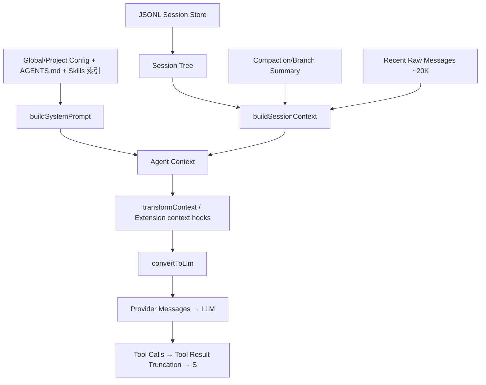

# Pi Agent 上下文工程技术实现调研

> 调研对象：Pi Agent Harness / Pi Coding Agent（`earendil-works/pi`）
> 调研时间：2026-09-14
> 重点：Context Engineering、Session、Compaction、Project Context、Skills、Tool Context、Extension Hooks、Prompt Cache

---

## 1. 核心结论

Pi 采用分层 Context Engineering Pipeline，而非单纯长上下文或对话摘要：

```text
持久化完整历史 (JSONL Session Tree)
  → 沿 root→leaf 取当前分支
  → Compaction Summary 替换过旧历史
  → 保留最近 ~20K token 原文
  → 叠加 System Prompt / AGENTS.md / Skill 索引
  → Extension Hook 动态裁剪/注入
  → Tool Result 限流
  → convertToLlm → Provider Messages
```

六条设计原则：

1. **完整历史 ≠ 活跃上下文**：Session 永久保存，但不全量发给模型。
2. **上下文可重建**：由 Session Tree + Compaction + Project Context 动态计算。
3. **近文远摘**：最近约 20K token 保留原文，更旧部分用 Summary。
4. **按需披露**：Skills 常驻仅 name + description，全文按需读取。
5. **Tool Result 限流**：工具输出是上下文预算主要消费者。
6. **上下文可 Hook**：模型调用前可二次裁剪/注入。

---

## 2. 整体架构



最终 LLM 请求组成：

```text
LLM Context =
  Stable System Prompt
  + Project Instructions
  + Skill Index
  + Compacted Historical State
  + Recent Raw Conversation
  + Current Tool Results
  + Per-turn Dynamic Context
```

上下文分四类：

| 类型       | 内容                                                                  | 披露方式         |
| ---------- | --------------------------------------------------------------------- | ---------------- |
| Static     | System Prompt、Tool Description、Project Instructions、Skill Metadata | 常驻             |
| Historical | Messages、Tool Calls/Results、Compaction/Branch Summary               | 当前分支动态组装 |
| Dynamic    | `before_agent_start`、context hooks、runtime 注入                   | 每轮变化         |
| External   | Skill 全文、仓库文件、完整 Tool Output、文档                          | Tool 按需获取    |

---

## 3. System Prompt 与 Project Context

源码：`packages/coding-agent/src/core/system-prompt.ts` → `buildSystemPrompt(options)`

运行时按启用 Tools、Tool Prompt Guidelines、自定义 Prompt、Project Context、Skills、cwd 动态生成，无固定模板。

Project Context 加载链：

```text
~/.pi/agent/AGENTS.md
父目录 AGENTS.md / CLAUDE.md
项目 AGENTS.md / CLAUDE.md
SYSTEM.md / APPEND_SYSTEM.md
```

使用显式 XML Boundary 避免与文件内 Markdown 混淆：

```xml
<project_context>
  <project_instructions path="/project/AGENTS.md">...</project_instructions>
</project_context>
```

自研建议：为 context source 标注 `type/path/priority`，便于 priority、tracking、expiration、debugging。

资源统一由 `packages/coding-agent/src/core/resource-loader.ts`（`DefaultResourceLoader` / `loadProjectContextFiles()`）发现：Context Files、Skills、Extensions、Prompt Templates、Themes、Pi Packages。**Context 本身是可发现 Resource，而非散落字符串拼接。**

---

## 4. Skills：Progressive Disclosure

结构：`my-skill/{SKILL.md, scripts/, references/, assets/}`，frontmatter 含 `name` + `description`。

流程：

```text
扫描 Skills → 只注入 name+description 进 System Prompt
→ 模型判断相关 → 用 read/bash 读完整 SKILL.md → 执行
```

即 `Metadata Always In Context / Full Content On Demand`。

100 个 Skill × 2K token = 200K 会直接占满上下文；Pi 只需约 30–100 token/Skill。

可抽象为分层能力披露：

```text
L0 capability metadata → L1 SKILL.md → L2 references/*.md → L3 scripts/
```

---

## 5. Session：Tree 而非线性列表

源码：`packages/coding-agent/src/core/session-manager.ts`，JSONL 存于 `~/.pi/agent/sessions/`。

Entry 带 `id / parentId / timestamp`，形成树；`leafId` 指向当前分支。当前 Context 只沿 `root → current leaf` 构造，天然支持 branch / fork / rollback / alternate path。

Entry 类型：

```text
message | compaction | branch_summary | custom | custom_message
| model_change | thinking_level_change | label | session_info
```

关键区分：

- `custom`：进 Session Store，**不进** LLM Context（Runtime State）
- `custom_message`：进 Session Store，**且进** LLM Context（Model-visible Context）

即数据模型层就分离了 Agent Runtime State 与 Model-visible Context。

`buildSessionContext()`：`buildSessionPath(entries, leafId)` → `buildContextEntries` → `sessionEntryToContextMessages`。

```text
Session Entries → Path Resolution → Compaction Resolution → AgentMessage → LLM Context
Session File ≠ LLM Messages
```

---

## 6. Compaction（核心）

源码：`packages/coding-agent/src/core/compaction/{compaction,utils}.ts`

### 6.1 触发与参数

```text
contextTokens > contextWindow - reserveTokens
```

默认配置：

```json
{ "compaction": { "enabled": true, "reserveTokens": 16384, "keepRecentTokens": 20000 } }
```

200K 窗口约在 184K 时触发。

### 6.2 Recency-preserving Compaction

```text
System Prompt
Historical Summary          ← Cut Point 之前
Recent Raw Messages ~20K    ← keepRecentTokens
Current User Message
```

流程：从最新向前扫 → 保留 `keepRecentTokens` → 定 Cut Point → 序列化更旧历史 → LLM 生成结构化 Summary → 写入 `CompactionEntry` → 重新 `buildSessionContext()`。

### 6.3 不删除历史

`CompactionEntry { summary, firstKeptEntryId, tokensBefore }` 只追加到 Session：

```text
上下文 = Compaction Summary + messages[firstKeptEntryId ... currentLeaf]
Disk History = Lossless；Active LLM Context = Lossy
```

### 6.4 Rolling Summary

多次压缩递归接力：`History A → Summary A + Recent B` → `Summary AB + Recent C`，形成 Rolling Summary / Recursive Context Handoff。

### 6.5 结构化 Summary（State Distillation）

不是“总结一下对话”，而是抽取：

```markdown
## Goal
## Constraints & Preferences
## Progress (Done / In Progress / Blocked)
## Key Decisions
## Next Steps
## Critical Context
<read-files>...</read-files>
<modified-files>...</modified-files>
```

另存结构化 `CompactionDetails { readFiles, modifiedFiles }`，来源：Tool Calls + Previous Compaction + Branch Summary，**累积合并**。自研可扩展为：

```json
{
  "summary": "...",
  "files_read": [], "files_modified": [],
  "commands_run": [], "artifacts_created": [],
  "decisions": [], "todo": []
}
```

### 6.6 Summary 载荷中的 Tool Result

序列化为 `[User]/[Assistant]/[Tool result]` 时，Tool Result 最多保留 **2000 字符**，超出记 `[... N more characters truncated]`。两层 Tool Output 控制：正常 Context 一层，Summarization Payload 再一层。

### 6.7 Split Turn 与切割规则

单 Turn 超过 `keepRecentTokens` 时，Cut Point 可落在 Turn 中间（Split Turn），分别处理 Previous History + Current Turn Prefix。

**硬规则：不在 Tool Result 上切断**——Tool Call 与 Tool Result 语义耦合，拆开会形成破碎上下文。

### 6.8 Run 中间触发

Tool Result 入上下文后、下一次 Assistant Response 前就会检查阈值；长 Tool Loop 内即可压缩，无需等新 User Message。

---

## 7. Branch Summarization

`/tree` 切换分支时，把被离开分支摘要后插入新分支：

```text
A → E → F + Summary(B,C,D)
```

实现 Cross-branch State Transfer：模型切换后仍知道另一分支做过什么。

---

## 8. Tool Result Truncation

官方要求：Tools MUST truncate output。

默认限制：**50 KB 或 2000 lines**（先到先截）。

按工具选策略：

| 工具类型      | 策略             | 原因                                     |
| ------------- | ---------------- | ---------------------------------------- |
| read / search | `truncateHead` | 开头更重要                               |
| bash / log    | `truncateTail` | 末尾的 FAIL / Stack Trace / Error 更关键 |

截断后完整输出落盘/临时文件，Context 内只留截断结果 + 路径提示，模型需要时可再读——同样是 Progressive Disclosure。

---

## 9. Extension Hooks 与消息转换

### 9.1 `pi.on("context")`

每次 LLM call 前触发，可 filter/inject messages：

```ts
pi.on("context", async (event, ctx) => ({
  messages: event.messages.filter(m => !shouldPrune(m))
}));
```

流程：`Session Context → Extension Context Hook → Provider Message`。

### 9.2 `pi.on("before_agent_start")`

可改 System Prompt、注入 Custom Message；可按 Git Branch / 任务类型路由不同 Context（动态 Context Router）。

### 9.3 `transformContext`（Agent Core）

```ts
transformContext?: (messages: AgentMessage[], signal?: AbortSignal)
  => Promise<AgentMessage[]>
```

路径：`AgentMessage[] → transformContext() → convertToLlm() → Provider Messages`。可在此做 pruning、RAG injection、memory retrieval、ranking、dedup、custom compaction。Context Policy 未写死在 Core。

### 9.4 `convertToLlm`

Runtime Message Schema ≠ LLM Message Schema。例如 `branchSummary` / `compactionSummary` 会转成带 `<summary>` 边界的说明文本。

---

## 10. Prompt Cache

- `PI_CACHE_RETENTION=long`：Anthropic extended cache ≈ 1h，OpenAI ≈ 24h
- 可传 `sessionId` 做 cache / session affinity
- 目标：**保持 Prompt 前缀稳定**（System Prompt / Project Instructions / Tool Definitions）
- Compaction / Branch Summary 属 one-off prompt：换新 routing session id，Provider 支持时 **disable prompt-cache writes**（区分 Reusable vs One-off Context）

---

## 11. 设计优点与局限

### 优点

1. Storage ≠ Context（历史与活跃上下文分离）
2. Session Tree 原生支持 branch
3. Summary 是结构化 State Handoff，非自由摘要
4. 保留近期原文，减少细节损失
5. Tool Output 有明确预算
6. Skills Progressive Disclosure
7. 上下文管线开放（`transformContext` / `context` / `before_agent_start` / `session_before_compact`）

### 局限

1. **Compaction 仍 Lossy**：Summary 漏掉约束/变量名/失败尝试/错误日志会导致重复犯错
2. **Summary 依赖 LLM**：可能遗漏/误总结/过度压缩；关键状态应结构化旁路保存（Pi 已用 `readFiles/modifiedFiles` 起步）
3. **AGENTS.md 整文件注入**：几十 KB 会长期占 Context；可改 AGENTS index + section retrieval
4. **Skill 展开依赖模型判断**：可能该读未读；关键 Workflow 可加 Rule-based Skill Router 或 LLM classifier
5. **无跨 Session Semantic Retrieval**：不做 embedding/BM25；长期记忆需自建 Memory Index / Entity Store

### Pi 默认不做的事

- 非 Vector Memory / Knowledge Graph / 跨会话语义记忆
- 不默认 Repo embedding RAG；哲学是 Tool-based Retrieval + File-based Context + Session Compaction
- 不强制内置 Subagent（planner/coder/reviewer）；核心保持小，Subagent 可用 Extension 自建，且应有**独立 Context Window**，而非共享膨胀消息列表

---

## 12. 可直接借鉴的工程决策清单

1. Session 持久化无损，LLM Context 动态计算（`firstKeptEntryId` 边界）
2. 近文远摘：`keepRecentTokens=20K` + Rolling Summary
3. Summary 做 State Distillation + 结构化文件/命令轨迹
4. Tool Result 双层限流（正常 50KB/2000 行；摘要载荷 2000 字符），read 截头 / bash 截尾
5. 不在 Tool Call–Result 对上切割；Split Turn 单独处理
6. Tool Loop 中间检查压缩阈值
7. Skill 仅元数据常驻，内容按需
8. Context Source 用 XML boundary 标注 path/type/priority
9. Runtime State（`custom`）与 Model-visible（`custom_message`）分型存储
10. 开放 transformContext / context hook，Context Policy 可插拔
11. Prompt Cache：前缀稳定 + one-off 请求禁写 cache
12. Subagent 独立 Context Window
