 

# 1.上下文记忆

### 当前项目采用“完整历史持久化 + 活跃上下文滚动压缩”的单会话记忆方案：

- 完整的用户与助手消息保存在 SQLite 中，原始历史不会因上下文压缩而删除。
- **当活跃历史超过约252ktokens 时，系统将较早内容整理为结构化摘要，并保留最近约40k tokens 的原始消息。**
- **后续请求使用“历史摘要 + 最近原文 + 当前问题”构造模型上下文；摘要会递归更新，使长会话可以持续滚动。**
- 摘要作为隐藏记录持久化，不在聊天界面显示；摘要失败时自动退化为最近消息，不阻断当前请求。
- 同一会话上传的数据文件会保存附件元数据。下一轮会校验并恢复仍然存在的历史附件，使 Agent 能继续读取数据；本轮同名新文件优先，越界、缺失或伪造路径会被忽略。
- **对历史 user/assistant 正文（+ 旧摘要）做状态交接提炼** ；不是对历史工具轨迹做压缩。工具结果从不进压缩源，也不会因压缩而重新出现在下一轮 prompt 里。

```mermaid
flowchart TB
    subgraph Persist["持久层（完整历史，不删）"]
        DB["SQLite sessions/messages<br/>server/store.py"]
    end

    subgraph Compile["上下文编译（每轮请求前）"]
        RM["compile_rolling_context<br/>data_analysis/context/rolling_memory.py"]
        ST["system.md + project_context<br/>+ tool protocol"]
        SEC["AgentState<br/>memory_summary + recent_messages + observations"]
    end

    subgraph Decision["决策时消息组装"]
        LM["AgentLoop.build_messages<br/>agent/loop.py"]
    end

    DB --> RM
    RM -->|"摘要 + 最近原文"| SEC
    RM -->|"新压缩记录 ROLE_TOOL"| DB
    ST --> LM
    SEC --> LM
    LM --> LLM["调用 LLM"]
```



### 1. 滚动记忆（跨轮）

实现集中在 `data_analysis/context/rolling_memory.py`，入口是 `compile_rolling_context`。

| 机制         | 当前取值 / 行为                                                                                                                              |
| ------------ | -------------------------------------------------------------------------------------------------------------------------------------------- |
| Token 估算   | 启发式：ASCII≈4字符/token，中文等非 ASCII≈1字符/token（`estimate_text_tokens`）                                                          |
| 压缩触发     | 活跃上下文估算 >**252,000** tokens（`COMPACTION_TRIGGER_TOKENS`）                                                                    |
| 保留最近原文 | 约**40,000tokens**（`KEEP_RECENT_TOKENS`），且**按完整 user 轮次**切，不拆开 user/assistant 对                                 |
| 压缩产物     | 结构化 Markdown：Goal / Constraints / Progress(Done/In Progress/Blocked) / Key Decisions / Next Steps / Critical Context / Files & Artifacts |
| 递归压缩     | 旧摘要会和「新变旧的原文」一起再次压成新摘要（`<previous_summary>`）                                                                       |
| 历史是否删除 | **不删**。压缩记录作为 `role=tool`、`metadata.kind=agent_compaction` 追加进 SQLite                                                 |
| 摘要失败     | 不阻断用户请求：退回「旧摘要/无摘要 + 最近原文」，并记录`compaction_error`                                                                 |

### 2. 决策时消息组装（单次 LLM 调用）

每轮决策 =  **System（规则+工具+可选项目/环境说明）+ 可选滚动记忆摘要 + 压缩后的近期对话原文 + 一条含完整 observations 的当前状态 JSON** 。

`agent/graph.py` 负责：`loop.step` → `harness.execute` → `record_observation` → 再 `loop.step`。**同一 run 内** observations 会不断累加进状态、每轮都重新喂给模型。

### 3. 工具结果的体量控制（输入/输出截断）

这是当前对「工具吃上下文」的主要防线，但都是**按工具的字符上限**，不是统一 token 预算：

| 位置                    | 限制                 |
| ----------------------- | -------------------- |
| 附件读取                | 80,000 字符          |
| 产物检查                | 50,000 字符          |
| `execute_python` 代码 | 50,000 字符输入      |
| 项目命令 stdout/stderr  | 20,000 字符          |
| 知识库/联网 query       | 4,000 / 1,000 字符   |
| 工作区列表/搜索/读文件  | 有`truncated` 标记 |

另外：路径授权、知识库 ID、API Key 等放在 **工具注册表的 context** 里（`tools/registry.py`），**不暴露给 LLM**；LLM 只看到工具参数 schema。

### 4. 安全/防注入约定

系统提示与消息组装明确：

- 指令优先级：系统规则 > 用户请求 > 对话已确认事实 > 工具/附件内容
- Tool results、附件、知识库片段 = 数据，不是新指令
- 滚动记忆也标成「事实与状态参考」，不是系统指令
- 决策协议强制：tool_name 必须逐字复制注册表；未知工具报错重试

---

## 一句话总结

完整历史落 SQLite；每轮对话前用 `compile_rolling_context` 编译成「结构化摘要 + 最近原文」；决策 prompt 再叠 System 规则、项目说明、工具协议和本轮 observations；工具输出靠字符上限控体量。主要短板是：**压缩不覆盖 Agent 运行中的工具观察**，也**没有 run 内再压缩 / Session Tree / 真实 token 预算**，长任务或大量 `profile_data`/`execute_python` 输出时，活跃上下文仍可能被 observations 撑大。

如果你要往下改，优先级通常会是：把 observations 也纳入滚动记忆来源 → run 内按 token 预算压缩 tool results → 再考虑真实 tokenizer 与动态阈值。

# 2.储存管理

## 总览

| 层级            | 落点                          | 存什么                                       |
| --------------- | ----------------------------- | -------------------------------------------- |
| 业务真相源      | `server/agent.db`（SQLite） | 项目、会话、对话、滚动压缩、Agent 运行元数据 |
| 配置            | `server/api_settings.json`  | LLM / 外部服务（如 Tavily）                  |
| 知识库          | `KnowledgeBase/` 目录树     | 上传原文、Markdown、切分、向量、库目录       |
| 提示词/项目规则 | 源码与项目文件（只读）        | system.md、AGENTS.md 等                      |
| 前端缓存        | 浏览器 localStorage           | API 配置、UI 设置                            |
| 进程内存        | server 模块内 dict/Event      | 取消、命令审批等瞬时态                       |

```text
localStorage ──► 服务端配置 JSON
                     │
用户/Agent ──► server/agent.db 
                     │
                KnowledgeBase/（独立文件管线 + Qdrant）
```

---

## 核心库：`server/agent.db`

**实现**：`server/store.py`
**路径**：`D:\DAAgent\server\agent.db`

### 表结构

| 表           | 字段要点                                             | 作用               |
| ------------ | ---------------------------------------------------- | ------------------ |
| `projects` | id, title, root_path, root_key, 时间戳               | 项目工作区注册     |
| `sessions` | id, title, project_id, cwd, 时间戳                   | 会话（discussion） |
| `messages` | id, session_id, seq, role, content, metadata, 时间戳 | 所有消息与扩展业务 |

`metadata` 为 JSON 字符串；`UNIQUE(session_id, seq)`。

### role 使用（数据 Agent 场景）

| role          | 含义                                                                                           |
| ------------- | ---------------------------------------------------------------------------------------------- |
| `user`      | 用户消息；metadata 可含`attachments`、`knowledge_base_ids`、`mode`                       |
| `assistant` | 模型最终回答；metadata 可含`sources`、`agent_run_id`、`agent_trace`、`agent_artifacts` |
| `tool`      | 非对话记录；当前数据 Agent 侧主要用于**`kind=agent_compaction` 压缩摘要**                    |

> 说明：`kind=modeling` 的 tool 消息属于建模链路，本总结不展开。

### 关键 API

- `append_message`：追加消息，会话不存在则创建
- `update_message_metadata`：合并 metadata
- `get_session` / `delete_session` / `rename_session` / `list_sessions`
- `get_message` / `list_tool_messages`

### 对话门面：`server/discussions.py`

- `save_discussion_message`：一轮写入 user + assistant
- `get_discussion`：组装前端结构，并**剔除** `agent_compaction` 消息
- 删除会话 = 删 session + 级联 messages

---

**一句话**：
储存管理以 **`server/agent.db` 为唯一业务库**（对话 + 滚动压缩元数据 + 项目/会话），**知识库走独立文件+Qdrant 管线**；配置与提示词分文件存放；工具历史结果不进入跨轮对话储存，也不参与压缩回放。

# 3. Agent Loop

## 1. 三层分工

| 模块                      | 文件                                 | 职责                                                              |
| ------------------------- | ------------------------------------ | ----------------------------------------------------------------- |
| **Loop（决策）**    | `data_analysis/agent/loop.py`      | 组装 prompt → 调 LLM → 解析 Action/Finish，**不执行工具** |
| **Harness（执行）** | `data_analysis/runtime/harness.py` | 解析注册表、调工具/沙箱，返回标准化 Observation                   |
| **Graph（编排）**   | `data_analysis/agent/graph.py`     | 串联：决策 → 执行 → 写回状态 → 再决策                          |

```text
loop.step(state)  ──►  Action | Finish
        │
        ├─ Finish ──► 写入 user/assistant，结束
        │
        └─ Action ──► harness.execute ──► Observation
                              │
                              ▼
                     state.record_observation
                              │
                              ▼
                         下一轮 step
```

ReAct 是 Loop 内的**思考策略**（Thought → Action → Observation）。

---

## 2. 决策协议：每次只输出一个 JSON

`AgentLoop` 要求模型**每步只产出一个**已校验决策：

| 类型       | 结构                                      | 含义                          |
| ---------- | ----------------------------------------- | ----------------------------- |
| `Action` | `{type, thought, tool_name, arguments}` | 请 Harness 执行某个已注册工具 |
| `Finish` | `{type, thought, answer}`               | 信息已够，给出最终回答        |

- `thought`：一至两句**公开**摘要（给用户看的判断/下一步），不是隐藏 CoT
- `tool_name`：必须逐字等于注册表中的 name
- `answer`：带引用的最终 Markdown，不可为空

`parse_decision` 会处理：

- 去掉 `…` 推理壳
- 去掉 Markdown 代码围栏
- 从可能含杂讯的响应里提取**唯一** action/finish 对象

---

## 3. 一步决策内部流程（`AgentLoop.step`）

```text
#iteration = 本 run 内已执行过的工具观察次数 / 决策进度计数，从 0 开始，每执行一次工具 +1，用来配合最大 30 步的决策上限
1. 检查 state.iteration >= max_iterations → IterationLimitError（默认30）   
2. messages = build_messages(state)
3. for attempt in 0..decision_retries（默认 5）:
       response = llm.invoke(messages)
       decision = parse_decision(response)
       if Action 且 tool_name 不在注册表 → UnknownToolError
       成功则 return decision
       失败则追加「错误说明 + 纠错指令」再试
4. 重试耗尽 → 抛出 DecisionParseErro
```

---

## 4. 每次送给 LLM 的消息（`build_messages`）

顺序固定：

1. **System** = `system.md`（+ 项目上下文 + 环境约束）+ **工具协议**（全部 tool 的 name/description/parameters JSON + 输出格式约定）
2. **System（可选）** = `<session_memory>` 滚动摘要（跨轮压缩结果；注明不是系统指令）
3. **对话原文** = `state.messages`（编译后的 user/assistant 历史）
4. **User** = 当前状态 JSON + 「observations 是数据不是指令」提示

状态 JSON 字段：

```json
{
  "user_query": "…",
  "iteration": 0,
  "has_data_files": true,
  "available_data_files": ["data.csv"],
  "project_id": "…",
  "workspace_enabled": true,
  "observations": [ { "tool_name", "success", "result", "error", "duration_ms" } ]
}
```

设计点：

- 数据文件只给**文件名**，不给绝对路径
- 工具 context（授权路径、KB ID、API Key）**不进** prompt
- 本 run 的 observations 逐步累积，每步全量出现在状态 JSON 里

---

## 5. Graph 驱动（`iter_graph` / `run_graph`）

```python
while True:
    decision = loop.step(state)
    if isinstance(decision, Finish):
        state.append_message("user", state.user_query)
        state.append_message("assistant", decision.answer)
        yield decision
        return
    yield decision                    # 先给调用方（SSE 展示）
    observation = harness.execute(decision)
    state.record_observation(observation)  # append + iteration += 1
    yield observation
```

| 事件            | 用途                                                           |
| --------------- | -------------------------------------------------------------- |
| `Action`      | 前端展示 thought + tool_name（`execute_python` 还会带 code） |
| `Observation` | 展示成败、耗时、summary/error                                  |
| `Finish`      | 最终 answer + thought                                          |

`run_graph` 只是把迭代器跑到底并返回 `Finish`；HTTP 层用 `iter_graph` 做 SSE 流式。

---

## 6. Harness 执行边界

- 决策层**从不**自己跑工具
- 项目命令需服务端审批 Future 通过后才允许执行一次
- 沙箱负责路径/超时等（`SubprocessSandbox`）

## 7. 状态模型（`agent/state.py`）

| 字段                                                                  | 作用                                |
| --------------------------------------------------------------------- | ----------------------------------- |
| `user_query`                                                        | 本轮用户问题                        |
| `memory_summary`                                                    | 滚动记忆摘要                        |
| `messages`                                                          | 对话历史（编译后）                  |
| `observations`                                                      | **本 run** 工具结果，逐步追加 |
| `iteration`                                                         | 已决策次数                          |
| `data_paths` / `output_dir` / `workspace_root` / `project_id` | 运行上下文                          |

跨轮：`messages` 来自库；`observations` **不**持久化进对话，下一轮从空开始（除非模型在 answer 正文里写了结论）。

## 10. 一张总图

```text
┌──────────── server/main.py ────────────┐
│ session → rolling memory → AgentState  │
│ registry + Loop + Harness + SSE        │
└──────────────────┬─────────────────────┘
                   ▼
┌──────────── agent/graph.py ────────────┐
│  while:  step → [Action|Finish]        │
│          Action → harness → Observation│
│          Finish → append messages      │
└──────┬───────────────────┬─────────────┘
       ▼                   ▼
 agent/loop.py        runtime/harness.py
 build_messages       registry.resolve
 llm.invoke           sandbox / in-process
 parse_decision       Observation 标准化
 纠错重试              命令人工审批
       │
       ▼
 tools/registry.py → 各工具实现
 context/rolling_memory.py → 跨轮摘要（请求入口）
```

**一句话**：当前 Agent Loop 是 **「决策与执行分离的串行 ReAct」**——`loop` 只产出经校验的 `Action`/`Finish`，`harness` 负责安全执行并标准化观察，`graph` 编排循环并流式暴露轨迹；跨轮靠滚动记忆压缩对话正文，run 内靠累积 observations 供下一步决策。

# 4. Agent harness

Harness 是 **Loop（决策）和工具真正执行之间的「身体」**：只负责把一次已校验的 `Action` 安全跑完，并永远返回一条标准 `Observation`，不抛异常给决策层。

## 1. 在链路中的位置

```text
AgentLoop.step  →  Action {tool_name, arguments, thought}
                        │
                        ▼
              Harness.execute(action)
                        │
        ┌───────────────┼────────────────┐
        ▼               ▼                ▼
  人工审批拦截     进程内工具        子进程沙箱
  (项目命令)    (LLM/知识库等)   (多数工具/代码)
        │               │                │
        └───────────────┴────────────────┘
                        ▼
              Observation {tool_name, success, result/error, duration_ms}
                        │
                        ▼
              state.record_observation → 下一轮决策
```

---

## 2. `Harness.execute` 逐步做什么

实现：`data_analysis/runtime/harness.py`

| 步骤                | 行为                                                                                                                            |
| ------------------- | ------------------------------------------------------------------------------------------------------------------------------- |
| 1. 计时             | `started_at = time.monotonic()`                                                                                               |
| 2. 项目命令门禁     | `tool_name == "run_project_command"` 且 `command_approval` 未通过 → 直接失败 Observation：「项目命令未获人工批准，未执行」 |
| 3. 解析工具         | `registry.resolve(tool_name)`；未知工具 → 失败 Observation                                                                   |
| 4. 执行分流         | `run_in_process=True` → `tool.invoke(arguments)`；否则 → `sandbox.execute(tool, arguments)`                             |
| 5. 异常兜底         | `ToolNotFoundError` / `SandboxError` / `ValueError` / `RuntimeError` → 失败 Observation，`error=str(exc)`            |
| 6. 项目命令二次校验 | 若结果 dict 里`exit_code != 0` → 失败，error 含退出码 + stderr/stdout 截断约 1000 字符                                       |
| 7. 成功             | `Observation(success=True, result=…, duration_ms=…)`                                                                        |

核心契约：

- **任何路径都返回 Observation**，决策循环不会因工具失败而崩掉
- 成功时 `error` 必须为 `None`；失败时 `error` 非空（与 `state.Observation` 校验一致）
- Harness **不**改写 LLM 参数语义，只做审批、路由、标准化

## 3. 执行两条通道

### 3.1 进程内（`register_in_process`）

必须留在主进程的工具（例如要复用当前 LLM / 本地向量库）：

| 工具                                            | 原因                                          |
| ----------------------------------------------- | --------------------------------------------- |
| `search_knowledge_base`                       | 调本地 KnowledgeBase / Qdrant 检索            |
| `inspect_image` / `inspect_generated_image` | 需要`vision_llm` 对象，不能 JSON 塞进子进程 |
| （`search_web` 等）                           | 以注册方式为准；主进程内调外部 API 更直接     |

进程内：`RegisteredTool.invoke(arguments)` → `handler(arguments, context)`。
context 可含非 JSON 对象（如 `llm`），`run_in_process=True` 时不做「context 必须可 JSON 序列化」校验。

### 3.2 子进程沙箱（默认，`run_in_process=False`）

绝大多数工具：数据画像、读附件、工作区读写、`write_artifact`、`execute_python`、项目文件编辑/命令等。

**父进程 `SubprocessSandbox.execute`：**

1. 把请求序列化为 JSON：`{entrypoint, arguments, context}`
   - `entrypoint` 形如 `data_analysis.tools.code_tools:execute_python_code`
2. 限制：payload ≤ **256 KB**，stdout ≤ **2 MB**，超时服务端配置 **2 小时**
3. 启动：

```text
<python> -m data_analysis.runtime._sandbox_worker
cwd = 项目根 或 仓库根
env = 精简环境变量 + PYTHONPATH=仓库根
```

4. 解析子进程 stdout JSON：`{ok, result}` 或 `{ok:false, error_type, error}`
5. 映射错误：超时 → `SandboxTimeoutError`；非零退出/坏 JSON/超限 → `SandboxProtocolError`；工具失败 → `SandboxToolError`

**子进程 `_sandbox_worker`：**

- 只允许 `entrypoint` 模块前缀：`data_analysis.tools.`
- 调用 `handler(arguments, context)`，结果必须可 JSON 序列化
- 异常统一成 `{ok:false, error_type, error}` 写回 stdout

沙箱对沙箱工具 context 有要求：**必须是合法 JSON**（路径列表、output_dir 字符串等），避免把不可序列化对象传进子进程。

---

## 4. Registry 在 Harness 侧的职责

| 对象                     | 内容                                                                  |
| ------------------------ | --------------------------------------------------------------------- |
| `ToolSpec`             | 给 LLM 看的 name / description / parameters（无执行逻辑、无 context） |
| `RegisteredTool`       | spec + handler +**context** + `run_in_process`                |
| `ToolRegistry.resolve` | 按名取工具；不存在则`ToolNotFoundError`                             |
| `ToolRegistry.specs`   | 只导出 spec 给`AgentLoop` 组 prompt                                 |

典型 context（**不进 LLM prompt**，只在执行时给 handler）：

- `authorized_paths`、`output_dir`、`workspace_root`
- `knowledge_base_ids`、`api_key`（Tavily）
- `python_executable` / 环境来源
- 识图用的 `llm`

---

## 5. 错误与 Observation 对照

| 情况                                | Observation                               |
| ----------------------------------- | ----------------------------------------- |
| 项目命令未批准                      | `success=false`, error=未获批准         |
| 工具名不存在                        | `success=false`, ToolNotFoundError 文案 |
| 参数/上下文不合法                   | ToolArgumentsError 等 → 失败             |
| 沙箱超时 / 协议错误 / 工具业务失败  | 对应 Sandbox* 文案                        |
| `run_project_command` 退出码 ≠ 0 | 失败，含 exit_code 与输出摘录             |
| 正常返回                            | `success=true`, result=工具 JSON        |

Harness **不**自动重试；重试策略在决策层（看 observation 后自己改参数再调）或系统提示要求模型「依据错误修改后再试」。

---

## 6. 和 Loop / Graph 的边界

|      | Loop            | Harness       | Graph                  |
| ---- | --------------- | ------------- | ---------------------- |
| 职责 | 下一步做什么    | 如何安全执行  | 何时 step / execute    |
| 输入 | AgentState      | Action        | state + loop + harness |
| 输出 | Action / Finish | Observation   | 事件流                 |
| 不做 | 执行工具        | 解析 LLM 输出 | 组 prompt              |

---

## 7. 当前实现特点与边界

**已有：**

- 决策/执行解耦，失败统一成 Observation
- 默认子进程隔离 + 环境变量白名单 + 入口模块白名单
- 项目命令人工审批、一次性生效
- 进程内通道服务 LLM/检索类工具
- 超时与 payload/output 字节上限

**边界 / 未做更重的隔离：**

| 点                 | 说明                                                                                  |
| ------------------ | ------------------------------------------------------------------------------------- |
| 沙箱强度           | 独立进程 + 受限 env，**不是**完整容器/OS 级沙箱；工作目录仍是项目/仓库根        |
| 超时很长           | 单次工具**2 小时**，整轮 Agent **3 小时**，偏「本地可信工具」而非秒级网关 |
| 无自动重试         | 全靠模型看到 error 后自行修正                                                         |
| Observations 体积  | run 内每次全量进入状态 JSON，工具结果很大时上下文会胀（截断多在各工具内部）           |
| `execute_python` | 走注册的代码工具链路（再进更内层 runner），Harness 只负责调用与标准化                 |

---

## 9. 一句话

**当前 Harness =「审批门禁 + 注册表路由 + 进程内/子进程双通道执行 + 强制 Observation 化」**：
Loop 只决定「调什么」；Harness 负责「能不能调、在哪调、失败怎么记」，并把结果变成决策循环可继续消费的标准化观察。

# 5. RAG

# 6.前后端
